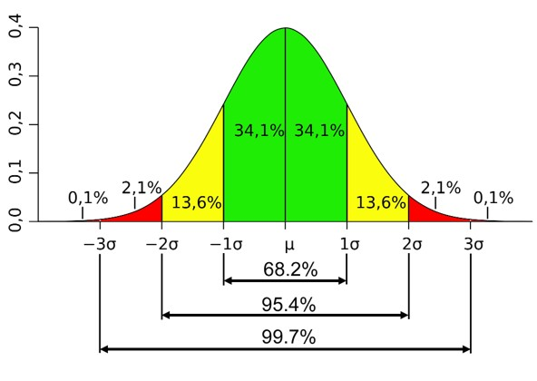



Inmiddels zijn we bekend met datasets, observaties, variabelen, meetniveaus en figuren. We hebben ook benoemd dat statistiek draait om het analyseren van *variatie* met behulp van de variabelen die in onze dataset zitten. Denk aan: variatie in drugsgebruik, uitgaansgedrag, leeftijden en opleidingsniveau. Om de variatie te analyseren maken we gebruik van diverse centrum- en spreidingsmaten. De meeste hiervan zul je herkennen van eerdere wiskundelessen die je hebt gehad.

## Centrummaten

### Gemiddelde

Het gemiddelde $\bar{x}$ berekenen we simpelweg door voor de variabele $x$ alle observaties bij elkaar op te tellen $\sum_{i=1}^n{x_i}$ en dan te delen door het aantal observaties $n$. Dit gaat middels de volgende formule.

$$
\bar{x}=\frac{\sum_{i=1}^{n}{x_i}}{n}
$$

Formules berekenen en statistische toetsen uitvoeren kunnen we ook handmatig in R doen. Dit is leerzaam, omdat het intuïtie creëert voor hoe je statistisch onderzoek moet uitvoeren.

Stel we nemen vijf respondenten uit de dataset en bekijken hun leeftijd. We vinden de volgende observaties voor leeftijd: 16, 22, 22, 28 en 33.

Hieronder berekenen we in R de gemiddelde leeftijd van deze vijf respondenten.

```{r}
# handmatig gemiddelde berekenen
(16 + 22 + 22 + 28 + 33) / 5
```

De gemiddelde leeftijd van deze vijf respondenten is is dus 24,2. In plaats een handmatige berekening kun je het ook berekenen middels de functie *mean()* in R:

```{r}
# vector aanmaken
x <- c(16, 22, 22, 28, 33)
print(x)

# gemiddelde berekenen
mean(x)
```

Eerst hebben we een vector, of eigenlijk een variabele, aangemaakt met de vijf observaties. Via de functie *mean()* bereken je vervolgens het gemiddelde.

### Mediaan

De mediaan is het getal waar het midden van het aantal observaties is bereikt (50%), oftewel de middelste observatie.

Bij de leeftijdsreeks (16, 22, [22]{.underline}, 28, 33) is dit 22 jaar.

Bij een even aantal cijfers zoals (16, 22, 22, 25, 28, 33) neem je het midden van de middelste twee getallen. In dit geval is dat 23,5 (tussen 22 en 25 jaar).

In R bereken je de mediaan via de functie *median().*

```{r}
# oneven aantal observaties
median(x)

# even aantal observaties
y <- c(16, 22, 22, 25, 28, 33)
print(y)

median(y)
```

### Modus

De modus is de waarde die het vaakst voorkomt in een variabele.

Bij de leeftijdsreeks (16, [22]{.underline}, [22]{.underline}, 28, 33) is dit 22 jaar omdat deze leeftijd tweemaal voorkomt en de rest slechts één keer.

In R bereken je de modus via de functie *mfv().*

```{r}
# modus berekenen
mfv(x)
```

## Spreidingsmaten

Tekst toevoegen over belang spreiding =\> Joost

### Bereik, minimum en maximum

Het bereik $R$ van een variabele is de afstand tussen de laagste (minimum: $x_{min}$) en hoogste (maximum: $x_{max}$) waarde. Dit bereken je eenvoudig door de hoogste waarde minus de laagste waarde te nemen:

$$R=x_{max}-x_{min}$$

Bij de leeftijdsreeks (16, 22, 22, 28, 33) is het minimum 16 en het maximum 33. Het bereik is dus $R=x_{max}-x_{min}=33-16=17$

```{r}
# handmatig bereik berekenen
33 - 16
```

Je kunt in R het minimum en maximum opvragen met de functies *min()* en *max()*. Ook kun je allebei tegelijk krijgen met de functie *range()*

```{r}
# minimum opvragen
min(x)

# maximum opvragen
max(x)

# minimum en maximum opvragen
range(x)
```

De functie *range()* geeft je alleen het minimum en maximum. Als je het bereik wilt weten, moet je zelf het minimum van het maximum aftrekken:

```{r}
# bereik berekenen
max(x) - min(x)
```

### Variantie

De variantie is een maat voor de spreiding van een variabele die aangeeft hoeveel de waardes onderling van elkaar verschillen. In de statistiek van de sociale wetenschappen zijn er twee soorten variantie: de populatievariantie en steekproefvariantie. Hier komen we later op terug, we rekenen nu voorlopig verder met de steekproefvariantie. De formule daarvoor is:

$$
S^2=\frac{\sum_{i=1}^{n}{(x_i-\bar{x})^2}}{n-1}
$$ De steekproefvariantie $S^2$ kun je bereken in een aantal stappen.

Dit doen we aan de hand van de leeftijdsreeks (16, 22, 22, 28, 33) en het gemiddelde hiervan $\bar{x}$ = 24,2

Eerst berekenen we voor elke observatie de afstand tot het gemiddelde (de deviatie):

| $x_i$ |  $x_i-\bar{x}$   |
|:-----:|:----------------:|
|  16   | 16 - 24,2 = -8,2 |
|  22   | 22 - 24,2 = -2,2 |
|  22   | 22 - 24,2 = -2,2 |
|  28   | 28 - 24,2 = 3,8  |
|  33   | 33 - 24,2 = 8,8  |

De optelsom van alle deviaties moet altijd nul zijn: -8,2 + -2,2 + -2,2 + 3,8 + 8,8 = 0

In de volgende stap kwadrateren we alle deviaties:

| $x_i$ |  $x_i-\bar{x}$   | $(x_i-\bar{x})^2$  |
|:-----:|:----------------:|:------------------:|
|  16   | 16 - 24,2 = -8,2 | $(-8,2)^2 = 67,24$ |
|  22   | 22 - 24,2 = -2,2 | $(-2,2)^2 = 4,84$  |
|  22   | 22 - 24,2 = -2,2 | $(-2,2)^2 = 4,84$  |
|  28   | 28 - 24,2 = 3,8  |  $3,8^2 = 14,44$   |
|  33   | 33 - 24,2 = 8,8  |  $8,8^2 = 77,44$   |

Daarvan nemen we de som der kwadraten $\sum_{i=1}^{n}{(x_i-\bar{x})^2}$ : 67,24 + 4,84 + 4,84 + 14,44 + 77,44 = 168,8

In de laatste stap delen we de som der kwadraten door het aantal observaties minus één ($n-1$) :

168,8 / (5-1) = 42,2

De steekproefvariantie van de leeftijd van vijf respondenten is dus 42,2.

Deze stappen kunnen we ook in R uitvoeren.

```{r}
# deviatie voor elke leeftijd
x_deviatie <- x - mean(x) # voor elke waarde van x minus het gemiddelde
print(x_deviatie)

# kwadrateren van deviaties
x_deviatie_kwa <- x_deviatie^2 # voor elke deviatie het kwadraat nemen
print(x_deviatie_kwa)

# som der kwadraten
sum(x_deviatie_kwa) # sum() neemt de som van een vector

# steekproefvariantie berekenen
variantie_stkpr <- sum(x_deviatie_kwa) / (length(x) - 1) # length() berekent het aantal rijen
print(variantie_stkpr)
```

In R kun je met de functie *var()* de steekproefvariantie ook direct berekenen

```{r}
# steekproefvariantie 
var(x)
```

### Standaarddeviatie

De variantie is een handig getal om mee te rekenen, maar heeft meestal op zichzelf niet zoveel betekenis. Daarom wordt in onderzoek gebruik gemaakt van de standaarddeviatie (ook wel standaardafwijking genoemd). In combinatie met het gemiddelde en het bereik, geeft de standaarddeviatie meestal een redelijke indicatie van de spreiding van een lineaire variabele (hier komen we later weer op terug). Hoewel wiskundig niet helemaal correct, wordt de standaarddeviatie ook wel gezien als 'de gemiddelde afstand tot het gemiddelde'.

De standaarddeviatie is de wortel van de steekproefvariantie:

$$
s=\sqrt\frac{\sum_{i=1}^{n}{(x_i-\bar{x})^2}}{n-1}
$$

De standaarddeviatie van ons voorbeeld met de leeftijd van vijf respondenten is:

$s=\sqrt{42,2}=6,50$

Je zou dus kunnen zeggen dat een willekeurige persoon van de vijf respondenten 'gemiddeld' 6,5 jaar afwijkt van de gemiddelde leeftijd van 24,2 jaar.

```{r}
# standaarddeviatie berekenen
sqrt(variantie_stkpr) # sqrt() berekent de wortel over een getal/vector
```

Je kunt de standaarddeviatie ook direct in R krijgen met *sd()*

```{r}
# standaarddeviatie
sd(x)
```

## Toepassing op de dataset

We hebben hierboven middels een eenvoudig voorbeeld laten zien hoe de centrum- en spreidingsmaten berekend worden. In onderzoek willen we deze informatie voor variabelen in de hele dataset weten, zodat we snel kunnen zien hoe onze data in elkaar zit.

We vragen hier het gemiddelde, de mediaan en de modus op voor leeftijd in de complete dataset.

```{r}
# centrummaten opvragen
mean(data_uitgaan$leeftijd) # gemiddelde
median(data_uitgaan$leeftijd) # mediaan
mfv(data_uitgaan$leeftijd) # modus
```

De gemiddelde leeftijd is 23,5 jaar, de mediaan is 23 jaar en de modus is 22 jaar. Deze waarden liggen dus dicht bij elkaar.

We kunnen ook het minimum, maximum, bereik en de standaarddeviatie berekenen.

```{r}
# spreidingsmaten opvragen
range(data_uitgaan$leeftijd) # minimum en maximum
max(data_uitgaan$leeftijd) - min(data_uitgaan$leeftijd) # bereik
sd(data_uitgaan$leeftijd) #standaarddeviatie
```

De minimumleeftijd is 16 jaar, de maximumleeftijd is 35 jaar en het leeftijdsbereik is 19 jaar. De standaarddeviatie is 4,8 jaar.

Veel van deze statistieken (min., max., mediaan, gemiddelde) kun je ook in één keer bekijken middels de functie *summary()*

```{r}
# meerdere statistieken tegelijkertijd opvragen
summary(data_uitgaan$leeftijd)
```

Je ziet dat de *summary()* functie ook de waardes voor 1st Qu. en 3rd Qu. geeft. Dit zijn het eerste en derde kwartiel, de grenzen waarbij respectievelijk 25% (Q1) en 75% (Q3) van de data ligt. In dit geval dus 20,0 en 27,0 jaar. Het tweede kwartiel (Q2) is de mediaan, dit is op de grens van 50% van de data.

### Doosdiagram

Er bestaat ook een manier om de spreiding van een lineaire variabele te visualiseren. Dit is via een **doosdiagram**.

```{r}
# doosdiagram maken
ggplot(data_uitgaan, aes(x = leeftijd)) + 
  geom_boxplot() # doosdiagram
```

Zoals we inmiddels hebben gezien, kan de presentatie van de figuur kan nog verbeterd worden.

```{r}
# doosdiagram maken
ggplot(data_uitgaan, aes(x = leeftijd)) + 
  geom_boxplot() + # doosdiagram
  theme_bw() +
  scale_x_continuous(breaks = seq(16, 35, by = 1)) + # aanpassen labels x-as, van 16 tot 35 met steeds 1 eenheid ertussen (1 jaar)
  scale_y_continuous(breaks = NULL) # verwijderen labels y-as (hebben geen betekenis hier)

```

Een doosdiagram weergeeft de spreiding van een variabele en bevat het minimum en maximum, en de grenzen van het 1ste kwartiel (Q1), mediaan (Q2) en 3de kwartiel (Q3). De afstand tussen het 1ste en 3de kwartiel wordt ook wel de **interkwartielafstand** genoemd.

Je kunt aan bovenstaande figuur bijvoorbeeld zien dat alle waarden tussen het 1ste kwartiel en mediaan tussen de 20 en 23 jaar liggen. Het hoogste kwartiel (Q4) omvat relatief veel leeftijden, van 27 tot 35 jaar.

Vergelijk deze doosdiagram met de staafdiagram van leeftijd ([Staafdigram leeftijd](%7B002-02-meetniveaus-visualisaties.qmd#sec-intervalratio%7D)). Je ziet dat er verschillende manieren zijn om data te visualiseren.

## Normale verdeling {#sec-normaleverdeling}

We hebben diverse centrum- en spreidingsmaten besproken. Deze kunnen we gebruiken om de verdeling van een variabele te visualiseren, afhankelijk van het meetniveau van de variabele (zie ook [Meetniveaus en visualisaties](002-02-meetniveaus-visualisaties.qmd)). Een van de meest bekende verdelingen in de statistiek is de **normale verdeling** (of normaalverdeling). Deze wordt gebruikt om verdeling van kwantitatieve variabelen te beschrijven, denk bijvoorbeeld aan lengte of IQ.

De normale verdeling heeft een aantal kenmerken:

- De verdeling bestaat uit een gemiddelde $\bar{x}$ en standaarddeviatie $s$
- Het gemiddelde en de mediaan zijn in principe gelijk aan elkaar. Dit betekent dat de verdeling symmetrisch is (50% van de observaties bevindt zich links van het gemiddelde, en 50% rechts)

Hieronder staat een afbeelding van de normale verdeling. 

De notatie in deze afbeelding is iets anders dan je tot nu toe gewend bent. Het gemiddelde wordt aangegeven met $\mu$ (spreek je uit als: mu) en de standaardafwijking met $\sigma$ (spreek je uit als: sigma). Deze symbolen zijn eigenlijk hetzelfde als $\bar{x}$ en $s$ , alleen gebruiken we $\mu$ en $\sigma$ om eigenschappen van de populatie te beschrijven terwijl $\bar{x}$ en $s$ gelden voor de steekproef (zie ook [Formuleblad](formuleblad.qmd)). Dit verschil komt terug bij [Inferentiële statistiek](003-01-steekproeven.qmd). Voor nu kun je er even van uitgaan dat ze hetzelfde betekenen.

De normaalverdeling noemen we ook wel een *kans*verdeling, omdat (onder bepaalde assumpties) een bepaald oppervlak onder de grafiek correspondeert met de kans op een waarde of uitkomst. Zo kun in de afbeelding bijvoorbeeld zien dat tussen één standaarddeviatie onder het gemiddelde ($-1\sigma$) en één standaarddeviatie boven het gemiddelde ($1\sigma$) 68,2% van alle waarden liggen. Verder geldt:

- tussen $-2\sigma$ en $2\sigma$ liggen 95,4% van alle observaties

- tussen $-3\sigma$ en $3\sigma$ liggen 99,7% van alle observaties

Dat een bepaald bereik op basis van standaarddeviaties correspondeert met een zeker percentage van alle observaties, staat ook wel bekend als **de empirische regel.** Je zult later bij het berekenen van een betrouwbaarheidsinterval en hypothese toetsen gaan zien waarom dit relevant is.

Het is belangrijk om op te merken dat in de praktijk variabelen zelden exact normaal verdeeld zijn, ze volgen dus niet precies de verdeling zoals hierboven weergeven. Zo kunnen kwantitatieve variabelen ook linksscheef of rechtsscheef verdeeld zijn, die daarvoor deze [link](https://www.scribbr.nl/statistiek/skewness-scheefheid/).

## Z-score

Om inzicht te krijgen in de relatieve positie van een bepaalde observatie ten opzichte van het gemiddelde, kunnen we ten slotte een z-score berekenen. Een z-score is een gestandaardiseerde maat die aangeeft hoeveel standaarddeviaties een waarde van het gemiddelde ligt. Daarbij geldt dat, door het standaardiseren, het gemiddelde altijd 0 is en de standaardafwijking 1. De z-score heeft de volgende formule:

$$ z=\frac{x-\bar{x}}{s} $$

De berekening is vrij eenvoudig: je trekt het gemiddelde $\bar{x}$ af van de specifieke waarde $x$ en deelt dit door de standaardafwijking $s$ van de originele variabele.

Laten we dit illustreren aan de hand van een voorbeeld. Bij [Histogram](002-02-meetniveaus-visualisaties.qmd#sec-histogram) zag je de variabele gemoed_dinsdag_na_xtc*,* die staat voor een score tussen de 0 en 100 over hoe positief respondenten zich voelen op de dinsdag na xtc-gebruik in het weekend. We vragen eerst het gemiddelde en de standaarddeviatie op.

```{r}
# gemiddelde en standaarddeviatie (met verwijderen missende waarden via na.rm)
mean(data_uitgaan$gemoed_dinsdag_na_xtc, na.rm = TRUE)
sd(data_uitgaan$gemoed_dinsdag_na_xtc, na.rm = TRUE)
```

We nemen als voorbeeld iemand die score 30 heeft ingevuld. Dan weten we in principe alle relevante informatie en kunnen we dit invullen in de formule:

$$ z=\frac{x-\bar{x}}{s}=\frac{30-58,3}{14,0} $$

We kunnen R gebruiken om dit uit te rekenen:

```{r}
(30-58.3)/14.0
```

De persoon met score 30 bevindt dus ongeveer 2 standaarddeviaties onder het gemiddelde. Zoals de normale verdeling laat zien, is dit een vrij extreme score (slechts 2,2% van de waardes ligt nog onder 2 standaarddeviaties).[^002-03-centrum-en-spreidingsmaten-1] Deze partyprins of -prinses voelt zich dus niet zo lekker vergeleken met de rest op de dinsdag na een wild weekend!

[^002-03-centrum-en-spreidingsmaten-1]: Vergelijk dit ook visueel met de verdeling van gemoed_dinsdag_na_xtc bij [Histogram](002-02-meetniveaus-visualisaties.qmd#sec-histogram). Waar ligt score 30 t.o.v. de rest van de verdeling?
