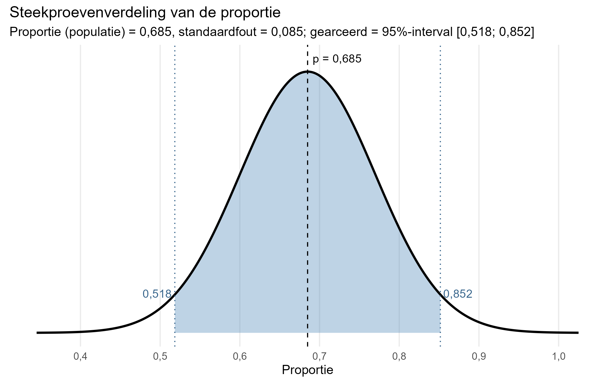
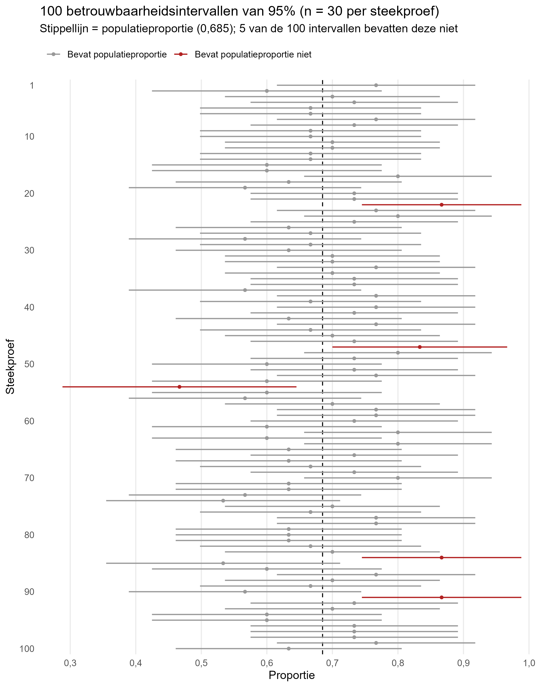



We zijn in het vorige hoofdstuk ingegaan op de principes van inferentiële statistiek, de steekproevenverdeling, de standaardfout, assumpties en mogelijke fouten die kunnen plaatsvinden.

We moeten nu een volgende stap maken, namelijk die van het trekken van één steekproef naar het schatten van de populatieparameter. Omdat we nooit helemaal zeker weten wat de populatieparameter is, schatten we met behulp van de standaardfout hoe dicht we in de buurt zitten (de foutmarge). Dit doen we aan de hand van een **betrouwbaarheidsinterval** (afkorting: bhi). We zullen in dit hoofdstuk in een aantal concrete stappen laten we zien we hoe dit doen.

## Betrouwbaarheidsinterval voor proporties

### Denkbeeldig voorbeeld

We beginnen met een denkbeeldig voorbeeld. We gaan er net als bij het vorige hoofdstuk vanuit dat we het populatieproportie en de standaardfout al kennen van xtc-gebruik onder uitgaande jongeren, waarbij we de dataset als populatie beschouwen. Dit is uiteraard zelden het geval (daarom doen we onderzoek!), maar voor de uitleg die volgt is dit wel handig.

Als we volgens de centrale limietstelling oneindig steekproeven trekken van 30 personen, willen we weten wat het bereik is van 95% van de steekproefuitkomsten (proporties in dit geval) rondom het populatiegemiddelde. Met 95% hebben we een aardig beeld van wat voor proporties de meeste steekproeven zouden opleveren. Dat is hieronder gevisualiseerd.



De afbeelding hierboven is afgeleid van het [voorbeeld](003-01-steekproeven.qmd#sec-steekproefcentraallimiet) uit het vorige hoofdstuk. Het toont dat we als herhaalde steekproeven zouden doen waarbij de proportie in de populatie van xtc-gebruik 0,685 is, dat 95% van de steekproeven een proportie tussen de 0,518 en 0,852 zou opleveren.

Waarom kiezen we hier voor 95%? Dat is afgeleid uit de empirische regel die we bij de [Normale verdeling](002-03-centrum-en-spreidingsmaten.qmd#sec-normaleverdeling) hebben besproken. Daar zag je bijvoorbeeld dat 95,4% van alle observaties tussen 2 standaarddeviaties boven en onder het midden van de verdeling liggen. 95% wordt vaak als conventioneel interval gebruikt, omdat het een breed interval betreft dat veel mogelijke uitkomsten bevat zonder dat het betekenisloos wordt.[^003-02-betrouwbaarheidsinterval-1] Het 95%-betrouwbaarheidsinterval correspondeert met 1,96 standaarddeviaties boven en onder het midden van de verdeling.

[^003-02-betrouwbaarheidsinterval-1]: Andere veelgebruikte betrouwbaarheidsintervallen zijn 90% en 99%. De bijbehorende standaarddeviaties zijn hierbij respectievelijk 1,65 en 2,58 (op basis van z-scores).

Aan de hand van de formule van betrouwbaarheidsinterval kunnen we zien hoe we dit berekenen:

$$
bhi = P \pm z\times\sigma_{\hat{p}} 
$$

of:

$$bhi \enspace ondergrens = P - z\times\sigma_{\hat{p}}$$

$$bhi \enspace bovengrens = P + z\times\sigma_{\hat{p}}$$

Je neemt dus:

- de (schatting van de) populatieparameter $P$
- telt daarbij op en trekt af de standaarddeviatie $z$ die je hebt gekozen voor de grens van het bhi. De $z$ komt van de (gestandaardiseerde standaarddeviaties) die je eerder hebt gezien.
- De $z$ moet je wel eerst vermenigvuldigen met de standaardfout $\sigma_{\hat{p}}$

We weten voor dit voorbeeld dat:

- $P=0,685$

- $z=1,96$ (we hebben gekozen voor een 95%-bhi)

Je hebt eerder gezien hoe je de [standaardfout](003-01-steekproeven.qmd#sec-standaardfout) berekent voor proporties. Je hoeft alleen de proportie en aantal respondenten in te vullen:

$$\sigma_{\hat{p}}=\sqrt\frac{\hat{p}(1-\hat{p})}{n}=\sqrt\frac{0,685(1-0,685)}{30}$$

```{r}
# berekenen standaardfout voor voorbeeld
sqrt(0.685*(1-0.685)/30)
```

De standaardfout is in dit geval dus 0,085.

Dan hoeven we in principe alleen nog de formule van het bhi in te vullen:

$$
bhi = P \pm z\times\sigma_{\hat{p}} = 0,685 \pm 1,96\times0,085
$$

We berekenen eerst het deel achter de $\pm$ ($z\times\sigma_{\hat{p}}$ ):

```{r}
# gedeelte achter +-
1.96*0.085
```

Dit is dus 0,167. Het bereik van het 95%-bhi ligt 0,167 boven en onder de populatieproportie van 0,685. Dit tellen we op/trekken we af van 0,685.

```{r}
# berekenen bhi
0.685-0.167 # ondergrens
0.685+0.167 # bovengrens
```

Voilà! We weten nu dus dat als we oneindig willekeurige steekproeven zouden trekken van 30 personen uit een populatie uitgaande jongeren, dat de proporties xtc-gebruik in 95% van de steekproeven tussen de 0,518 en 0,852 zouden liggen (als overige assumpties kloppen).

### Reëel voorbeeld

Het denkbeeldige voorbeeld is instructief, maar eigenlijk overbodig. We gingen er al vanuit dat de proportie in de populatie 0,685 was. Dan is het in principe niet meer nodig een betrouwbaarheidsinterval te berekenen.

We weten nu echter ook het volgende: omdat 95% van de verdeling van mogelijke steekproefproporties tussen 0,518 en 0,852 ligt (0,167 boven of onder 0,685), is de kans 95% dat een proportie van een willekeurige steekproef binnen dit bereik valt. Dit betekent dat als we herhaaldelijk een proportie $\hat{p}$ berekenen op basis van een willekeurige steekproef (van 30 personen in dit geval), en vervolgens een interval berekenen tussen $\hat{p}-0,167$ en $\hat{p}+0,167$ , dat dit interval de populatieproportie zal bevatten in 95% van de steekproeven.

Simpel gezegd, kunnen we in de formule $bhi = P \pm z\times\sigma_{\hat{p}}$ de $P$ vervangen door $\hat{p}$, en dan voor elke steekproef berekenen in welk interval de populatieparameter mogelijk ligt. We zullen daarbij ook de standaardfout $\sigma_{\hat{p}}$ opnieuw moeten berekenen, omdat die we berekend hebben aan de hand van $P=0,685$ maar die kennen we in de werkelijkheid niet. De nieuwe formule voor het schatten van een betrouwbaarheidsinterval is:

$$ bhi = \hat{p} \pm z\times\sigma_{\hat{p}}  $$

of:

$$bhi \enspace ondergrens = \hat{p} - z\times\sigma_{\hat{p}}$$

$$bhi \enspace bovengrens = \hat{p} + z\times\sigma_{\hat{p}}$$

We kunnen nu zien hoe dit werkt aan de hand van een voorbeeld. We trekken een steekproef van 30 personen en berekenen de proportie xtc-gebruikers in deze steekproef.

```{r}
set.seed(42)

# steekproef trekken van 30 personen uit populatie
sample_30 <- slice_sample(data_uitgaan, n = 30)

# proportie xtc-gebruikers berekenen
table(sample_30$xtc_ooit) |> prop.table()
```

De proportie xtc-gebruikers in deze steekproef is dus 0,633. Eerst berekenen we de nieuwe standaardfout:

$$\sigma_{\hat{p}}=\sqrt\frac{\hat{p}(1-\hat{p})}{n}=\sqrt\frac{0,633(1-0,633)}{30}$$

```{r}
# berekenen standaardfout voor willekeurige steekproef met 30 respondenten
sqrt(0.633*(1-0.633)/30)
```

De standaardfout is 0,088. Dan hebben we alle relevante gegevens om het 95%-betrouwbaarheidsinterval te berekenen:

$$
bhi = \hat{p} \pm z\times\sigma_{\hat{p}} = 0,633 \pm 1,96\times0,088
$$

```{r}
# gedeelte achter +-
1.96*0.088
```

```{r}
# berekenen bhi
0.633-0.172 # ondergrens
0.633+0.172 # bovengrens
```

De ondergrens van het 95%-bhi is in dit geval 0,461 en de bovengrens is 0,805. Dit noteren we ook wel als $[0,461; 0,805]$. Op basis hiervan concluderen we (voorlopig) dat in 95% van de herhaalde steekproeven de populatieproportie tussen deze twee waarden zou moeten liggen. In dit geval is dat correct: 0,685 ligt tussen 0,461 en 0,805.

Het principe van een 95%-bhi is hieronder uitgebeeld. Deze grafiek toont een simulatie waarin we 100 keer een steekproef hebben getrokken van 30 personen en voor elke steekproef het 95%-bhi hebben berekend. Wanneer een interval de populatieproportie bevat, dan overlapt het interval (horizontale grijze streep) met de verticale gestippelde lijn die de populatieproportie presenteert. In 5% van de steekproeven zie je dat het interval en de populatieproportie niet overlappen. Dit zijn steekproeven die toevallig een hele hoge of lage proportie van xtc-gebruikers hebben (rode kleur). Uitgaande van een 95%-bhi, valt de populatiewaarde dan buiten het interval bij deze steekproeven. We zitten er dus ook weleens naast met een steekproef, ook al is aan alle assumpties voldaan. Het voordeel is wel dat we weten hoe vaak we er naast zaten, namelijk in 5% procent van de steekproeven.



### Reëel voorbeeld #2 {#sec-reeelvoorbeeld2}

Hopelijk heb je inmiddels een beetje feeling gekregen voor betrouwbaarheidsintervallen. Het vorige voorbeeld was leerzaam, maar de uitkomst was een beetje teleurstellend. Dat we op basis van een steekproef van 30 personen weten dat in 95% van de steekproeven de populatieproportie xtc-gebruikers ergens tussen de 0,461 en 0,805 ligt is nog niet zo informatief. Het kan namelijk 0,461 zijn, of 0,805, of alles daar tussen in. Het maakt nogal uit of het 46,1% gebruikers gaat of om 80,5%! Stel je voor dat de media een bericht schrijft over jouw onderzoek, dan wil je toch wat nauwkeuriger kunnen zeggen hoeveel uitgaande jongeren ooit xtc hebben gebruikt.

We gaan nu kijken hoe de grootte van de steekproef hier van invloed is (zie ook het deel over de [standaardfout](003-01-steekproeven.qmd#sec-standaardfout)). We trekken nu geen steekproef van 30 personen, maar één van 10 en één van 100 personen. Eerst schrijven we even een functie om het 95%-bhi automatisch te berekenen, zodat we niet alles weer stap voor stap hoeven te berekenen.

```{r}
# functie schrijven voor 95%-bhi
bhi_95 <- function(p, n) {
  p + c(-1, 1) * 1.96 * sqrt(p * (1 - p) / n)
}
```

We trekken twee steekproeven van respectievelijk 10 en 100 personen, en berekenen de proporties.

```{r}
set.seed(42)

# steekproeven trekken van 10 en 100 personen
sample_10 <- slice_sample(data_uitgaan, n = 10)
sample_100 <- slice_sample(data_uitgaan, n = 100)

# proportie xtc-gebruikers berekenen
table(sample_10$xtc_ooit) |> prop.table() # 10 personen
table(sample_100$xtc_ooit) |> prop.table() # 100 personen
```

De proportie voor de steekproef met 10 personen bedraagt 0,700 en die voor 100 personen is 0,582. Nu berekenen we het 95%-bhi voor beide steekproeven.

```{r}
# 95%-bhi berekenen voor beide steekproeven
bhi_95(0.7, 10) # 10 personen
bhi_95(0.582, 100) # 100 personen
```

Je ziet grote verschillen tussen deze betrouwbaarheidsintervallen. De steekproef van 10 personen heeft een 95%-bhi tussen $[0,416; 0,984]$. Dit is een heel breed interval. De populatieproportie van 0,685 valt er wel binnen, maar dit zal sowieso in 95% van de steekproeven het geval zijn. Op basis van het interval zelf kunnen we niet veel zeggen over de mogelijke populatieproportie xtc-gebruikers. Dit zou alles tussen de 41,6% en 98,4% kunnen zijn.

Het 95%-bhi van de steekproef met 100 personen is daarentegen veel smaller: $[0,485; 0,679]$. Afgaande op dit interval, zou je stellen dat in 95% van de herhaalde steekproeven de proportie xtc-gebruikers in de populatie tussen de 48,5% en 67,9% ligt. Dit is nog steeds een redelijk breed interval, maar wel al nauwkeuriger dan wat we eerder hebben gezien. Toevallig valt de populatieproportie (0,685) buiten dit interval, we hebben dus een 5% misser hier!

We kunnen het voorbeeld van proportie xtc-gebruikers nu full circle afsluiten. We hebben de hele tijd voor didactische redenen aangenomen dat $P=0,685$ , de proportie uit de dataset. We laten nu het idee los dat we de populatieparameter zouden kennen, en schatten wat deze mogelijk zou kunnen zijn op basis van de hele dataset. Nu is $\hat{p}=0,685$. Herinner dat we xxx respondenten hebben in de dataset.

```{r}
# berekenen 95%-bhi voor de complete steekproef
bhi_95(0.685, 350)
```

Onze schatting is dat we met 95% van de gevallen kunnen zeggen dat de proportie xtc-gebruikers in de populatie uitgaande jongeren tussen 0,636 en 0,737 ligt, bij herhaalde steekproeven van xxx personen. Dus ergens tussen de 63,3% en 73,7%. Dat komt al aardig in de buurt van een vrij precies resultaat!

## Betrouwbaarheidsinterval voor gemiddeldes

Het is voor het oudere publiek wel even slikken, dat waarschijnlijk tussen 63,3% en 73,7% van de uitgaande jongeren weleens xtc heeft gebruikt. Je zal inmiddels wel redelijk klaar zijn met het schatten van de proportie xtc-gebruikers. Daarom gaan we nu naar een ander voorbeeld kijken.

We hebben ons tot nu toe vooral met proporties schatten bezig gehouden. Een proportie is een aandeel van iets dat in een score tussen de 0 en 1 wordt uitgedrukt, en is toepasbaar op veel variabelen. Naast xtc-gebruik zou je bijvoorbeeld ook naar het ooit-gebruik van sigaretten (ja/nee) of cocaine (ja/nee) kunnen kijken. Andere variabelen vragen echter om een andere statistiek, zoals leeftijd, aantal sigaretten of aantal glazen alcohol op een uitgaansdag. Daarvoor schatten we een gemiddelde, wat we nu zullen doen voor aantal glazen alcohol.

De formule voor een bhi van een populatiegemiddelde is net wat anders:

$$ bhi = \bar{x} \pm z\times\sigma_{\bar{x}}  $$

We nemen nu dus het gemiddelde van de steekproef $\bar{x}$ en de standaardfout van gemiddeldes $\sigma_{\bar{x}}$ . Deze laatste berekenen we volgens de formule:

$$ \sigma_{\bar{x}}=\frac{s}{\sqrt{n}} $$

We kunnen nu vrij eenvoudig schatten wat het gemiddeld aantal glazen alcohol is dat uitgaande jongeren drinken op een uitgaansdag. Let op dat deze statistiek alleen van toepassing is op mensen die minimaal één glas hebben gedronken. Eerst berekenen we het gemiddelde en standaarddeviatie in de dataset.

```{r}
# gemiddelde aantal glazen alcohohol
mean(data_uitgaan$glazen_alcohol_uitgaansdag, na.rm = TRUE)

# gemiddelde aantal glazen alcohohol
sd(data_uitgaan$glazen_alcohol_uitgaansdag, na.rm = TRUE)
```

Het gemiddelde is $10,7$ en de standaarddeviatie $5,8$. We weten al dat het aantal respondenten xxx is. Dan hebben we alle gegevens om een 95%-bhi te berekenen. Dit doen we als volgt:

$$ bhi = \bar{x} \pm z\times(\frac{s}{\sqrt{n}}) =10,7 \pm 1,96\times(\frac{5,8}{\sqrt{350}})  $$

We berekenen weer eerst het gedeelte achter $\pm$ ($1,96\times(\frac{5,8}{\sqrt{350}})$)

```{r}
# gedeelte achter +-
1.96*(5.8/sqrt(350))
```

En dit tellen we op/trekken we af van het gemiddelde:

```{r}
# 95%-bhi berekenen
10.7-0.61
10.7+0.61
```

Op basis van steekproef, kunnen we zeggen dat in 95% van herhaalde steekproeven (van 350 personen) het populatiegemiddelde van aantal glazen alcohol ergens tussen de $10,1$ en $11,3$ zal liggen. We kunnen dus wel redelijk zeker stellen dat het gemiddeld aantal glazen alcohol dat men drinkt zo 10 à 11 per uitgaansdag is. Je ziet dat het schatten van een populatiegemiddelde niet veel anders is dan het schatten van een proportie in de populatie.

## Interpretatie betrouwbaarheidsinterval

We hebben hierboven al een aantal keer een interpretatie van een betrouwbaarheidsinterval gegeven. Daarbij hebben we het er een beetje makkelijk vanaf gebracht, want een bhi heeft een meer uitgebreide interpretatie nodig dan we tot nu toe hebben gedaan. Een technische correcte interpretatie van een 95%-bhi is:

> Als we steekproeven oneindig herhalen en we berekenen een 95%-bhi voor voor alle steekproeven, dan zullen 95% van deze bhi's de ware populatieparameter bevatten (terwijl 5% van de bhi's deze niet bevatten).

Deze wat langdradige formulering weerspiegelt de achterliggende aannames van een bhi. Namelijk dat deze

1\) één schatting is van een serie van mogelijke steekproeven die we kunnen we trekken uit de populatie en ...

2\) dat er zoiets bestaat als een constante, vaste populatieparameter die het bhi wel of niet bevat.

Omdat we vaak maar één steekproef hebben in onderzoek, formuleren we de interpretatie van een bhi als volgt:

> We kunnen met 95% betrouwbaarheid stellen dat de ware populatieparameter ergens tussen \[ondergrens\] en \[bovengrens\] ligt, gebaseerd op (hypothetische) herhaalde steekproeven.

Vertalen we dit door naar ons voorbeeld over de proportie xtc-gebruikers, dan zou je de volgende interpretatie kunnen geven: *we kunnen met 95% betrouwbaarheid stellen dat de proportie uitgaande jongeren die ooit xtc hebben gebruikt ergens tussen de 0,636 en 0,737 ligt, gebaseerd op (hypothetische) herhaalde steekproeven.*

Een veelgemaakte fout bij het interpreteren van een bhi is dat men stelt dat er een 95% *kans* bestaat dat de populatieparameter in het interval ligt. Dit is niet juist, omdat de populatieparameter een vaste waarde is die *wel* of *niet* binnen het interval ligt. De kans dat een betrouwbaarheidsinterval de ware populatieparameter bevat, is daarmee 100% (wel) of 0% (niet). Om deze reden zeggen we juist dat 95% van alle mogelijke bhi's de populatieparameter zal bevatten.

We maken het ten slotte wederom nog een stukje ingewikkelder (sorry!). De uitspraak "met 95% betrouwbaarheid stellen we dat de proportie uitgaande jongeren die ooit xtc hebben gebruikt ergens tussen de 0,636 en 0,737 ligt, gebaseerd op (hypothetische) herhaalde steekproeven" is statistisch correct, maar niet per se neutraal of altijd overeenkomstig met de werkelijkheid. De uitspraak is puur gebaseerd op het onderzoek, maar neemt geen eerdere kennis in overweging.

Stel dat eerdere onderzoeken hebben aangetoond dat de proportie xtc-gebruik onder uitgaande jongeren lager ligt, rond de 30-40%. Is het dan echt nog zo aannemelijk dat we in 95% van de herhaalde steekproeven een populatiewaarde zo hoog als het onze zullen vinden in het interval? De eerdere kennis van het onderwerp heeft dus invloed op hoe we het bhi interpreteren en de geloofwaardigheid daarvan. We kunnen deze kennis niet zomaar aan de kant schuiven.

De gedachtegang hier geeft aan dat de interpretatie van een bhi subjectiever kan zijn dan we vaak denken. Er even hypothetisch van uitgaand dat de daadwerkelijke populatieproportie van xtc-gebruik veel lager ligt dan ons interval lijkt aan geven, zou een persoon met kennis hiervan die 95% betrouwbaarheid in twijfel trekken. Iemand zonder kennis zal het daarentegen wellicht een plausibel resultaat vinden. Een meer accurate interpretatie van een bhi is daarom:

> We kunnen met 95% betrouwbaarheid stellen dat de ware populatieparameter ergens tussen \[ondergrens\] en \[bovengrens\] ligt, gebaseerd op (hypothetische) herhaalde steekproeven *en geen additionele relevante kennis*.

Je zult inmiddels wel denken: wat moet ik hier allemaal mee (voor het tentamen)? We zullen wat duidelijkheid verschaffen op dit punt. We verwachten in ieder geval:

- Dat je de laatst gegeven interpretatie van een betrouwbaarheidsinterval consistent toepast op de variabelen die je onderzoekt tijdens de practica

- Dat je op basis van logisch redeneren en ervaring die je opdoet tijdens de cursus kan uitleggen hoe precies of nauwkeurig je de populatiemeter weet te schatten op basis van het bereik van het interval. In hoeverre is bijvoorbeeld een interval van proporties tussen 0,461 en 0,805 informatief (@sec-reeelvoorbeeld2)?

- Dat je begrijpt wat we bedoelen met "95% betrouwbaarheid ... gebaseerd op (hypothethische) herhaalde steekproeven" en hoe dit voorkomt uit de [steekproevenverdeling](003-01-steekproeven.qmd#sec-steekproefcentraallimiet)

- Dat je begrijpt waar de toevoeging "en geen additionele relevante kennis" vandaan komt en ook in hoeverre dit van toepassing kan zijn op zaken die zelf onderzoekt.

## Samenvatting

- Op basis van de steekproevenverdeling en empirische regel kunnen we voor elke steekproef berekenen, met een bepaalde mate van betrouwbaarheid, in welk interval de populatieparameter zal liggen. Hiervoor kiezen we doorgaans het 95%-betrouwbaarheidsinterval.

- Over het algemeen geldt dat het betrouwbaarheidsinterval smaller wordt (en daarmee nauwkeuriger) wanneer we meer data verzamelen.

- Bij het interpreteren van het bhi moeten we met verschillende assumpties en aspecten rekening houden. Dit is belangrijk omdat we daardoor meer bewust zijn van wat we eigenlijk aan het doen zijn.

In het volgende hoofdstuk...
