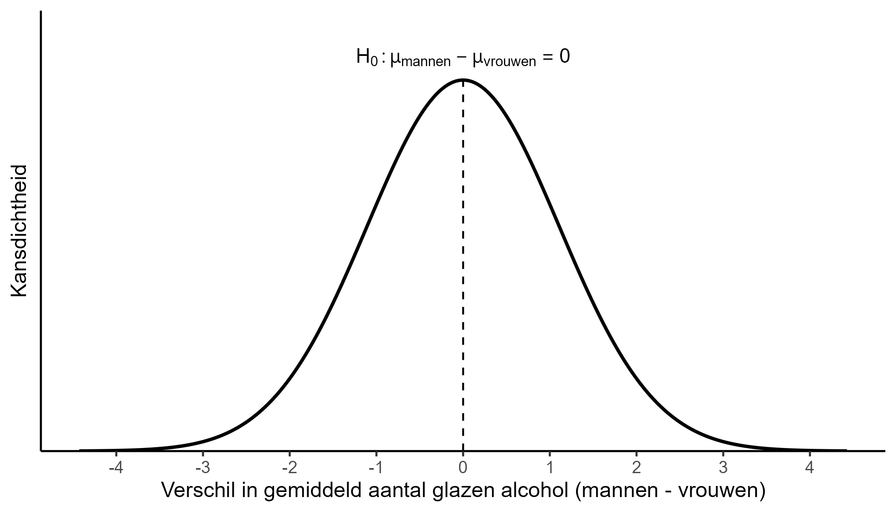
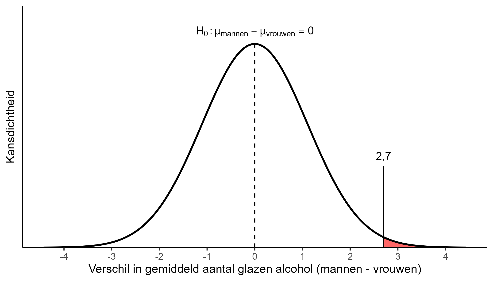
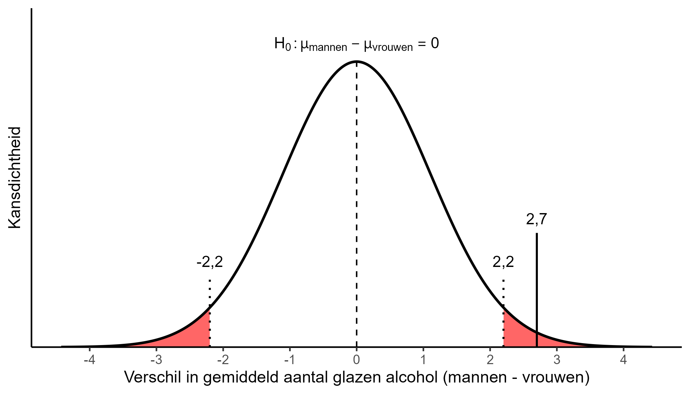
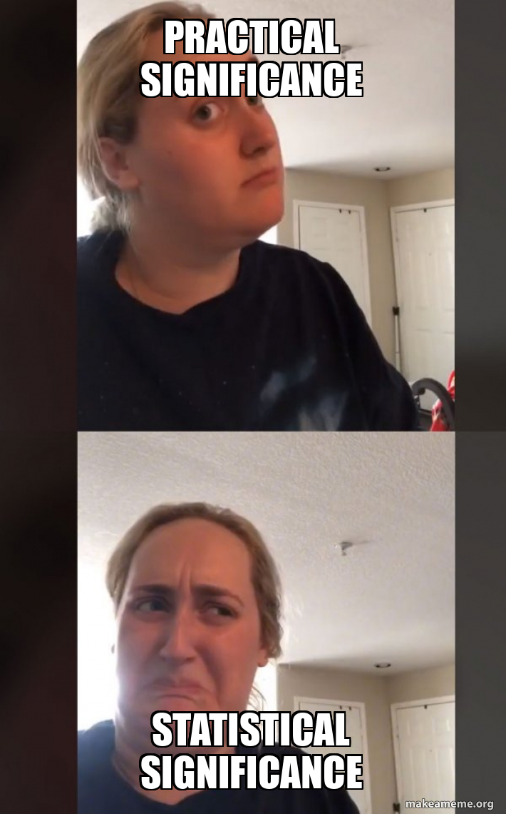



In het vorige deel hebben we kennis gemaakt met inferentiële statistiek. We bespraken hoe je op basis van een steekproef iets zinnigs kan zeggen over een bepaalde populatie en welke aspecten daarbij komen kijken. We keken vooral naar het schatten van een populatieparameter, bijvoorbeeld wat de proportie xtc-gebruik onder uitgaande jongeren is.

In statistisch onderzoek zijn we vaak geïnteresseerd in relaties tussen bepaalde dingen (zie ook de vragen bij [Data](002-01-data.qmd)), waarbij we verwachtingen hebben over hoe die relatie werkt of in elkaar zit. Zoals bij [Relaties tussen variabelen](002-04-relatiesvariabelen.qmd), kunnen we data verzamelen over bepaalde kenmerken van personen en dan de relaties hiertussen onderzoeken. Dit zegt alleen iets over de personen in de dataset, maar nog niet de bredere populatie.

Om onze verwachtingen over relaties in de populatie te onderzoeken, maken we daarom gebruik van **hypothesetoetsing**. "Hypotheses toetsen" betekent dat we een verwachting formuleren over hoe iets werkt in de populatie, dit vervolgens analyseren en dan uitspraken doen in hoeverre deze verwachting klopt. Daarbij houden we, net als bij de eerder behandelde betrouwbaarheidsintervallen, rekening met hoe zeker we kunnen zijn over de juistheid van onze uitspraak.

In dit hoofdstuk gaan we hypothesetoetsing uitleggen aan de hand van een concreet voorbeeld. Er zijn grofweg twee manieren om een hypothese te toetsen. De klassieke methode is volgens het criterium van **statistische significantie**. Hierbij bepaal je voor een bepaalde grenswaarde (significantieniveau) of een hypothese kan worden verworpen. Hoewel deze methode (nog steeds) de standaard is in sociaalwetenschappelijk onderzoek, is er ook veel kritiek op. Hier komen we straks op terug. De andere methode is (surprise, surprise) het uitrekenen van een betrouwbaarheidsinterval. We zullen uitleggen waarom deze laatste methode onze voorkeur geniet.

Er komen bij het toetsen van hypotheses meerdere zaken kijken. De basics daarvan zullen we in deze cursus behandelen. Het is echter goed te realiseren dat de onderzoekspraktijk vaak nog wat complexer is en je na deze cursus dus nog niet uitgeleerd bent. Op een aantal van die zaken gaan we de komende hoofdstukken dieper in. Het is dus niet erg als je nog niet alles meteen begrijpt.

Ten slotte werken we het voorbeeld eerst uit middels de overschrijdingskans, wat je de 'computerbenadering' zou kunnen noemen. In latere hoofdstukken werken we ook nog handmatige voorbeelden uit om meer inzicht te geven in het proces. Voor nu is het relevant dat je het principe van hypothesetoetsing snapt.

## Wie drinkt er meer?

Als voorbeeld kijken we naar het verschil tussen mannen en vrouwen in hoeveel glazen alcohol ze drinken tijdens een uitgaansdag. Er bevinden zich onder zowel mannen als vrouwen matige en stevige drinkers. Hoewel het algemene beeld wellicht is dat vooral mannen tijdens het stappen de sluizen flink open kunnen zetten, onderzoeken we voor dit voorbeeld of er überhaupt een verschil in alcoholconsumptie is. Je zult later zien waarom dergelijke formuleringen relevant zijn.

Merk meteen op dat we hier twee verschillende meetniveaus met elkaar in verband brengen. We willen voor een nominale variabele (geslacht) weten wat het verschil is in gemiddeldes op een ratio variabele (aantal glazen alcohol). Dit type toets noemen we een **t-toets voor onafhankelijke groepen**. Er zijn diverse varianten van de t-toets, waarvan we er twee in deze cursus zullen behandelen.

Het onderzoeken van verschillen in drankconsumptie tussen mannen en vrouwen geeft een uitdaging. Stel dat we data verzamelen onder een groep van 40 uitgaanders bestaande uit 20 mannen en 20 vrouwen, en vinden dat mannen gemiddeld 11,4 glazen per uitgaansdag drinken en vrouwen 8,7. Op basis van de steekproef weten we dan dat mannen gemiddeld $11,4-8,7=2,7$ meer glazen alcohol drinken dan vrouwen. We zouden op basis hiervan kunnen stellen dat er een verschil bestaat tussen mannen en vrouwen in drankconsumptie.

Je weet echter uit de vorige hoofdstukken dat deze steekproef slechts één resultaat is van een (hypothetisch) oneindig aantal mogelijke steekproeven. In een andere steekproef kan het zijn dat we vinden dat vrouwen evenveel drinken als mannen. Hoe kunnen we nu vaststellen dat, met een bepaalde mate van zekerheid, er over het algemeen een verschil bestaat in drankconsumptie tussen mannen en vrouwen?

Voor dit dilemma is de methode van hypothesetoetsing ontwikkeld. Het idee achter deze methode is in feite niet anders dan dat we gezien hebben bij het betrouwbaarheidsinterval. In plaats van de proportie xtc-gebruikers, nemen we nu het verschil tussen mannen en vrouwen in aantal glazen als onze te schatten populatieparameter en gaan we berekenen wat verdeling is van steekproefuitkomsten als we deze oneindig zouden herhalen. Hier komt de [steekproevenverdeling](003-01-steekproeven.qmd#sec-steekproefcentraallimiet) dus weer van pas!

Het aantal stappen bij hypothesetoetsing is uitgebreider dan bij het berekenen van een betrouwbaarheidsinterval. Die lopen we nu stap voor stap door.

## Statistische significantie {#sec-statistischesignificantie}

### 1) Hypothese opstellen {#sec-opstellenhypo}

De eerste stap is dat je jouw verwachting van de uitkomst zo expliciet mogelijk formuleert, dit wordt een **hypothese** genoemd. Hier volgt meteen een hersenkronkel. In statistisch onderzoek toetsen we namelijk niet wat we verwachten, maar juist het tegenovergestelde daarvan! Deze tegenovergestelde verwachting wordt de **nulhypothese** genoemd. Het werken met de nulhypothese vindt zijn oorsprong in het wetenschapsfilosofisch idee dat we aannemen iets nooit helemaal zeker te weten. Het is daarom makkelijker om het onwaarschijnlijke van wat we verwachten (de nulhypothese) te verwerpen, en er dan vanuit gaan dat het waarschijnlijke (onze originele verwachting) 'voorlopig' waar is. Dit staat bekend als het falsificatieprincipe van Karl Popper. *De nulhypothese wordt wel of niet verworpen, dit is in feite het centrale doel van statistisch wetenschappelijk onderzoek*. Bij [hypotheses formuleren](004-02-aspectenhypo.qmd#sec-hypoformuleren) bespreken we ook uitgebreider waar je op moet letten bij het formuleren van een nulhypothese.

Onze verwachting bij dit voorbeeld is dat er een verschil bestaat tussen mannen en vrouwen in hoeveel glazen alcohol ze drinken op een uitgaansdag. We gebruiken vaak statistische notatie dit expliciet te maken:

$$\mu_1 \neq \mu_2 $$

Dit betekent dat het gemiddelde in de populatie van de eerste groep ($\mu_1$) *niet gelijk is aan* het gemiddelde van de populatie van de tweede groep ($\mu_2$). Oftewel, het gemiddelde aantal glazen alcohol onder mannen is niet gelijk aan het gemiddelde aantal glazen alcohol onder vrouwen.

Draaien we dit om voor het formuleren van de nulhypothese, dan krijgen we:

$$\mu_1=\mu_2$$

Dit lezen we als: het populatiegemiddelde aantal glazen alcohol onder mannen ($\mu_1$) is *gelijk* *aan* het populatiegemiddelde aantal glazen alcohol onder vrouwen ($\mu_2$).

We zouden dit ook als volgt kunnen noteren:

$$\mu_1-\mu_2\ = 0$$

Oftewel, voor de nulhypothese verwachten we dat verschil tussen $\mu_1$ en $\mu_2$ gelijk is aan nul. Bij de nulhypothese verwacht je vaak geen verschil of in een andere richting dan je zou denken. Daarom wordt het de nulhypothese genoemd (nul verschil, nul samenhang, nul effect, etc.) 🤓.

### 2) Bepalen significantieniveau

Het **significantieniveau** is de grenswaarde waarbij we een nulhypothese verwerpen. Als de overschrijdingskans (p-waarde) kleiner is dan deze grenswaarde, verwerpen we de nulhypothese. Hier komen we bij de volgende stappen op terug. Gebruikelijke significantieniveaus in de statistiek zijn 0,01 (1%), 0,05 (5%) en 0,1 (10%). Net als bij dit voorbeeld gaan we meestal uit van een significantieniveau van 0,05.

### 3) Overschrijdingskans {#sec-overschrijdingskans}

De **overschrijdingskans**, ook wel p-waarde genoemd of simpelweg $p$, speelt een centrale rol in het toetsen van hypotheses.[^004-01-onafhankelijkegroepen-1] Het geeft aan hoe waarschijnlijk het resultaat verkregen uit onze steekproef is (of extremer), aangenomen dat de nulhypothese waar is.[^004-01-onafhankelijkegroepen-2]

[^004-01-onafhankelijkegroepen-1]: Let op dat $p$ hier naar iets heel anders verwijst dan $P$ en $\hat{p}$ uit de vorige hooddstukken. $p$ gaat over de overschrijdingskans terwijl $P$ en $\hat{p}$ gaan over proporties.

[^004-01-onafhankelijkegroepen-2]: 'Steekproefresultaat' verwijst hier naar de populatieparameter waarin we geïnteresseerd zijn: het gemiddelde verschil tussen mannen en vrouwen in drankconsumptie.

Je zult inmiddels wel denken: "waar zijn we nu weer aanbeland"?

::: {.content-visible when-format="html"}
{width="340"}
:::

Laten we het laag voor laag afpellen.

In de praktijk vormt de nulhypothese ons vertrekpunt. Vanuit de nulhypothese is de verwachting doorgaans dat er geen verschil is tussen groepen. Onze 'ware' populatiewaarde, gegeven de nulhypothese, is daarom nul. We maken een denkbeeldige steekproevenverdeling van mogelijke steekproefuitkomsten die hierbij past (zie ook [Steekproevenverdeling](003-01-steekproeven.qmd#sec-steekproefcentraallimiet) en [Betrouwbaarheidsinterval](003-02-betrouwbaarheidsinterval.qmd)). Dit noemen we ook wel de H~0~-verdeling of de verdeling onder de nulhypothese (zie hieronder).



De verdeling geeft een indicatie van hoe waarschijnlijk een bepaalde steekproefuitkomst is onder H~0~. Je kunt bijvoorbeeld zien dat een gemiddeld verschil van drie glazen zeer onwaarschijnlijk is: het ligt ver van de midden van de verdeling. Hoe groter de afstand tot H~0~, hoe eerder we de nulhypothese zullen verwerpen.

We kunnen nu de kans berekenen dat een bepaalde steekproefuitkomst voorkomt binnen deze H~0~-verdeling: de overschrijdingskans! We werken immers met een normaalverdeling en kunnen via de empirische regel nagaan wat de kans op een bepaalde uitkomst is (zie [Normale verdeling](002-03-centrum-en-spreidingsmaten.qmd#sec-normaleverdeling)).

We generen eerst de data die hoort bij ons voorbeeld. We hebben ons onderzoek verricht onder 20 mannen en 20 vrouwen, met respectievelijke gemiddeldes van 11,4 en 8,7 glazen alcohol. Voor het gemak gaan we er even vanuit dat de standaarddeviatie $s$ binnen beide groepen 3,5 is.

```{r}
set.seed(010)

# Trekt n respondenten en schaalt ze zodat gemiddelde en sd exact kloppen
genereer_groep <- function(n, gemiddelde, s) {
  rnorm(n) |> scale() |> as.vector() * s + gemiddelde
}

voorbeeld_alcohol <- data.frame(
  geslacht                     =  factor(rep(c("man", "vrouw"), each = 20)), # variabele mannen en vrouwen aanmaken
  glazen_alcohol_uitgaansdag   = 
    c(genereer_groep(20, 11.4, 3.5), genereer_groep(20, 8.7, 3.5)) # 20 respondenten per geslacht, met bijbehorende gemiddeldes en sd
)
```

Vervolgens berekenen we de overschrijdingskans die bij deze steekproef hoort.

```{r}
# t-toets uitvoeren om overschrijdingskans te berekenen
t.test(glazen_alcohol_uitgaansdag ~ geslacht, # variabelen bepalen
       data = voorbeeld_alcohol) # dataset 
```

De output van deze toets geeft aardig wat informatie. Voorlopig kijken we alleen naar de p-waarde (p-value), dit is onze overschrijdingskans. Deze bedraagt afgerond dus 0,019. Formeel interpreteren we de p-waarde als volgt:

> de kans op het verkrijgen van een steekproefresultaat minstens zo extreem als het huidige, aangenomen dat de nulhypothese waar is (en alle andere model assumpties).

Je kunt zien dat die kans in dit voorbeeld klein is (ongeveer 2%).

Het gemiddelde verschil tussen mannen en vrouwen dat we hebben gevonden in de steekproef bedraagt 2,7 glazen. Deze uitkomst ligt ver van het midden van de verdeling en is daarmee onwaarschijnlijk onder de H~0~-verdeling (zie figuur hieronder). Het corresponderende gebied onder de grafiek (de kans) is daarmee klein.



### 4) Vergelijken significantieniveau en overschrijdingskans

Nu resteert een laatste stap in het hypothese toetsen. We hebben gevonden dat de kans op een gemiddeld verschil van 2,7 glazen alcohol zeer onwaarschijnlijk is onder de nulhypothese ($p=0,019$). Dit is een sterke indicatie dat de nulhypothese kan worden verworpen. Er bestaat echter de mogelijkheid dat we (toevallig) een steekproef hebben getrokken die ver afligt van de H~0~-verwachting (herinner wederom de [Steekproevenverdeling](003-01-steekproeven.qmd#sec-steekproefcentraallimiet)). Volgens de methode van statistische significantie willen we met bepaalde zekerheid stellen of een nulhypothese moet worden verworpen of niet. Daarom kiest men voor een significantieniveau: een grens waarbij we de nulhypothese verwerpen met een bepaalde zekerheid.

In dit geval hebben we een significantieniveau van 0,05 gekozen. We kunnen in dit voorbeeld simpelweg de overschrijdingskans vergelijken met het significantieniveau. Als de eerste kleiner is dan de laatste ($p<\alpha$), dan verwerpen we de nulhypothese. Andersom ($p>\alpha$) doen we dit juist niet, dan verwerpen we de nulhypothese *niet*. Omdat hier $p=0,019$ kleiner is dan het significantieniveau van 0,05, verwerpen we de nulhypothese.

De technische interpretatie luidt als volgt:

> Als mannen en vrouwen in de populatie van uitgaanders gemiddeld evenveel zouden drinken, dan is een verschil van 2,7 glazen of meer (in een van beide richtingen) zo zeldzaam dat het in minder dan 5% van de herhaalde steekproeven voorkomt.

Daarom verwerpen we de nulhypothese en gaan er voorlopig vanuit dat er een statistisch significant verschil bestaat tussen mannen en vrouwen in hoeveel ze gemiddeld drinken.

Om dit verder te verduidelijken, tonen we de grenzen van aantal glazen alcohol waarbij je de nulhypothese moet verwerpen (zie onderstaande figuur). De rode zones aan het uiteinde van de verdeling noemen we het H~0~-verwerpingsgebied. Als we terugrekenen dan correspondeert een significantieniveau van 5% met 2,2 glazen alcohol bij dit voorbeeld. Als we een steekproefuitkomst vinden die voorbij deze grens ligt, dus lager dan -2,7 of hoger dan 2,7, dan verwerpen we de nulhypothese in principe bij een significantieniveau van 5%.



Let op dat we onder de nulhypothese zowel een positief (mannen drinken meer dan vrouwen) als negatief (vrouwen drinken meer dan mannen) verschil verwachtten, daarom ligt de grens van significantie in dit geval aan beide kanten van de H~0~-verdeling (zie LATER HOOFDSTUK).

## Wat nog meer...

Hierboven hebben we in notendop laten zien welke stappen je moet nemen bij het toetsen van een (nul)hypothese. Voor de eenvoud hebben we wel een aantal relevante aspecten achterwege gelaten. Dit betreffen de volgende zaken:

- Bij het berekenen van de overschrijdingskans moeten we rekening houden met de grootte van de steekproef. Dit doen we middels de t-verdeling, die wat anders in elkaar zit dan de [normale verdeling](002-03-centrum-en-spreidingsmaten.qmd#sec-normaleverdeling) waar we tot nu toe mee gewerkt hebben.
- Hypotheses kunnen eenzijdig of tweezijdig worden geformuleerd. Bij eenzijdig hebben we een specifiek idee over de richting van een verband (bijv. mannen drinken meer dan vrouwen), terwijl we bij tweezijdig er alleen vanuit gaan dat er een verschil. Dit bepaalt mede hoe we de toets uitvoeren en interpreteren.
- Bij een t-toets voor onafhankelijke groepen onderzoeken we hoe twee verschillende groepen (mannen en vrouwen) gemiddeld verschillen op één variabele (aantal glazen alcohol). Daarbij kun je ervan uitgaan dat de varianties gelijk of ongelijk zijn. Bij gelijke varianties is er binnen de groep mannen evenveel variantie (onderlinge verschillen) in drinkgedrag als binnen de groep vrouwen. Stel dat binnen de groep mannen veel meer diversiteit bestaat in lichte en zware drinkers dan bij de vrouwen, dan spreken we van ongelijke varianties. Voor het gemak gaan we in deze cursus steeds uit van ongelijke varianties, maar dit hoeft lang niet altijd zo te zijn.
- ASSUMPTIE VAN NORMALE VERDELING VOOR BEIDE GROEPEN.

De eerste twee punten komen uitgebreider aan bod in LATER HOOFDSTUK.

## Beperkingen statistische significantie

De methode van statistische significantie voor hypothesetoetsing, zoals hierboven beschreven, wordt veel toegepast in wetenschappelijk onderzoek. Je zult in veel wetenschappelijke studies lezen dat onderzoekers hebben gevonden dat een bepaald verschil tussen groepen of een effect 'significant' is. Ondanks de wijdverbreide toepassing is er echter ook veel kritiek op de methode van statistische significantie. Het is belangrijk om hier bewust van te zijn, zodat we niet dezelfde fouten reproduceren. Ook leert het ons beter begrijpen wat we wel en niet kunnen met statistisch onderzoek.

Een veelgemaakte fout is dat de uitkomst van een hypothesetoets verkeerd geïnterpreteerd wordt. Zo wordt de p-waarde vaak geïnterpreteerd als "de kans dat de nulhypothese waar is". Dit is echter geen juiste interpretatie. De p-waarde geeft ons slechts de kans op het verkrijgen van bepaalde data (een steekproefresultaat), aangenomen dat de nulhypothese waar is (onder de H~0~-verdeling dus). Op eenzelfde manier wordt vaak gezegd dat een statistisch significant resultaat bij een significantieniveau van 5% betekent dat "er een 95% kans is dat er verschil tussen groepen bestaat in de populatie", wat ook niet juist is.

Zulke verkeerde interpretaties hebben dezelfde oorsprong, namelijk dat men veronderstelt dat de uitkomst direct iets zegt over de kans dat de nulhypothese waar is of niet. Echter, strikt gezien kunnen we alleen iets zeggen over de kans op *het vinden een bepaalde gegevens of data* (het steekproefresultaat) *onder de aanname dat de nulhypothese waar is*. We gaan er dus vanuit de nulhypothese in principe waar is of niet, en dus niet voor 95% bijvoorbeeld (zie ook discussie van de [interpretatie van het betrouwbaarheidsinterval](003-02-betrouwbaarheidsinterval.qmd#sec-interpretatiebhi)).

Een andere veelgemaakte fout is het verwarren van 'statistisch significant' met **praktisch significant**. Praktisch significant betekent dat je een substantieel verschil of verband vindt met inhoudelijke relevantie. Stel dat uit jouw onderzoek blijkt dat mannen twee keer zoveel drinken dan vrouwen, bijvoorbeeld gemiddeld 10 vs. 5 glazen alcohol op een uitgaansdag. Dat is een behoorlijk verschil, wat ook gevolgen zal hebben voor wie als probleemdrinker wordt gezien en hoe beleid rondom alcoholpreventie moet worden vormgegeven. Dit is dus een bevinding waarbij de grootte van het verschil er toe doet.

Het kan aan de andere kant ook voorkomen dat je vindt dat er slechts een klein verschil bestaat tussen mannen en vrouwen in drankconsumptie, bijvoorbeeld 10 vs. 9 glazen respectievelijk. Het kan zijn dat je dan alsnog een statistisch significant verschil vaststelt, afhankelijk van de groepsvarianties en het aantal personen in de steekproef.[^004-01-onafhankelijkegroepen-3] Het verschil tussen 10 en 9 glazen is echter klein, waardoor het praktisch gezien bijna verwaarloosbaar is.

[^004-01-onafhankelijkegroepen-3]: Dit komt verder aan bod bij [Aspecten van hypothesetoetsing](004-02-aspectenhypo.qmd).

In de onderzoekspraktijk zul je vaker vinden dat er wel een bepaald verschil is, maar dat de substantiële betekenis hiervan niet meteen duidelijk is. In het voorbeeld op deze pagina is het gevonden gemiddelde verschil 2,7 glazen. Is dit veel of weinig? Dat is gedeeltelijk een subjectieve opvatting. In de sociale wetenschappen zijn er geen vastomlijnde regels van wanneer iets praktisch significant is, dat hangt af van de context. Meestal bepaal je de praktische relevantie aan de hand van logisch redeneren en afvragen waarom deze bevinding relevant is. Als je bijvoorbeeld gaat autorijden, kunnen 2-3 glazen een groot verschil maken. Voor een avond stappen waarin sowieso heel veel gedronken wordt, heeft een verschil van 2-3 glazen wellicht minder effect op de totale mate van intoxicatie. Context doet er dus toe.

## Betrouwbaarheidsinterval voor hypothesetoetsing

Bovenstaande duidt er op dat hypothesetoetsen via statistische significantie zijn beperkingen heeft. Deze komen er grotendeels op neer dat:

- de interpretatie van een significant resultaat regelmatig verkeerd gaat
- een focus op statistische significante afleidt van praktische significantie
- er weinig aandacht is voor hoe precies de populatieparameter wordt geschat

Deze beperkingen kunnen we grotendeels ondervangen door een alternatieve methode te gebruiken waar we al bekend mee zijn: het [betrouwbaarheidsinterval](003-02-betrouwbaarheidsinterval.qmd)! Een bhi kan ons informatie verschaffen over hoe groot een verschil is in populatiegemiddeldes, en met welke mate van zekerheid we dat kunnen vaststellen. Het werkt hier niet veel anders dan bij het schatten van een gemiddelde of proportie in de populatie, alleen nemen we deze keer een andere type populatieparameter: *het verschil tussen twee gemiddeldes* (voor onafhankelijke groepen). Volgens dezelfde principes die eerder hebben geleerd berekenen we voor deze populatieparameter een bhi.

Wellicht was het je opgevallen dat we dit al hebben gedaan. De output bij het berekenen van de @sec-overschrijdingskans geeft tevens een bhi. Die bedraagt voor het voorbeeld op deze pagina $[0,46; 4,94]$. Op basis van wat we eerder hebben gezien bij de [interpretatie van een betrouwbaarheidsinterval](003-02-betrouwbaarheidsinterval.qmd#sec-interpretatiebhi), kunnen we dit interval hier interpreteren als:

> We kunnen met 95% betrouwbaarheid stellen dat het gemiddelde verschil tussen mannen en vrouwen in glazen alcoholconsumptie op een een uitgangsdag ergens tussen de 0,46 en 4,94 ligt, gebaseerd op (hypothetische) herhaalde steekproeven engeen additionele relevante kennis.

We kunnen een dergelijk bhi op vrij simpele wijze gebruiken om tevens de nulhypothese te toetsen. Omdat we bij de t-toets gekozen hebben voor het standaard 5% significantieniveau, correspondeert dit met een (tweezijdig) 95%-bhi. Omdat onze verwachting onder de nulhypothese is dat het gemiddelde verschil 0 is, hoeven we alleen te kijken of die waarde in het geschatte bhi ligt. Dat is hier niet het geval: 0 valt niet binnen het bereik van $[0,46; 4,94]$ . Wat we al wisten, hebben we nu op alternatieve wijze aangetoond: de nulhypothese kan worden verworpen. We gaan er voorlopig vanuit dat er een statistisch significant verschil bestaat tussen mannen en vrouwen in hoeveel ze gemiddeld drinken.

Deze laatste observatie is op zich niet zo interessant. We zijn meestal geïnteresseerd in hoe groot dat verschil is (met andere woorden: praktische significantie). Het bhi vertelt ons iets over welke populatieparameter we zullen vinden in 95% van de herhaalde steekproeven. Dat blijkt hier nog behoorlijk uiteen te liggen. Het kan zowel 0,46 zijn (een half glas) of 4,94 (5 glazen), en alles daartussen in. Deze waardes hebben potentieel hele andere praktische implicaties, omdat een half glas in de meeste situaties verwaarloosbaar is terwijl vijf glazen dat niet zijn. Dit resultaat geeft dus nog niet een heel nauwkeurig beeld.

Je merkt hopelijk dat het hanteren en interpreteren van een bhi (in plaats van statistische significantie alleen) leidt tot een andere focus. We kijken meer naar de inhoudelijke en praktische betekenis, en niet alleen of iets statistisch significant is.

{width="50%"}

## Samenvatting

Je hebt in vogelvlucht kennis gemaakt met hypothesetoetsen en enkele relevante aspecten. We hebben hierboven gekeken naar een t-toets voor onafhankelijke groepen (met ongelijke varianties). Dit soort toets voeren we uit wanneer we de gemiddelde score op een kwantitatieve variabele willen vergelijken tussen twee groepen (nominale variabele). De belangrijkste punten van dit hoofdstuk zijn als volgt:

- In wetenschappelijk onderzoek hebben we verwachtingen over hoe iets werkt (relaties) in de populatie. Om die te toetsen formuleren we de nulhypothese: het tegenovergestelde van wat we verwachten.

- Via de methode van statistische significantie stellen we vast hoe (on)waarschijnlijk een bepaald steekproefresultaat is, gegeven de nulhypothese. Dit gebruiken om vast te stellen met welke mate van zekerheid een populatieparameter niet nul zal zijn.

- Een enge focus op statistische significantie heeft echter zijn beperkingen. In plaats daarvan gebruiken we bij voorkeur betrouwbaarheidsintervallen om zowel de nulhypothese te toetsen als praktische relevantie te bepalen.
