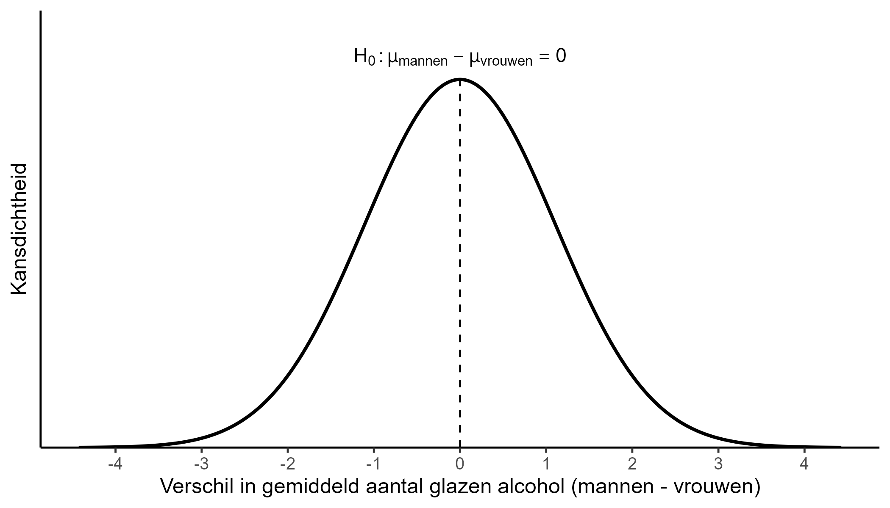
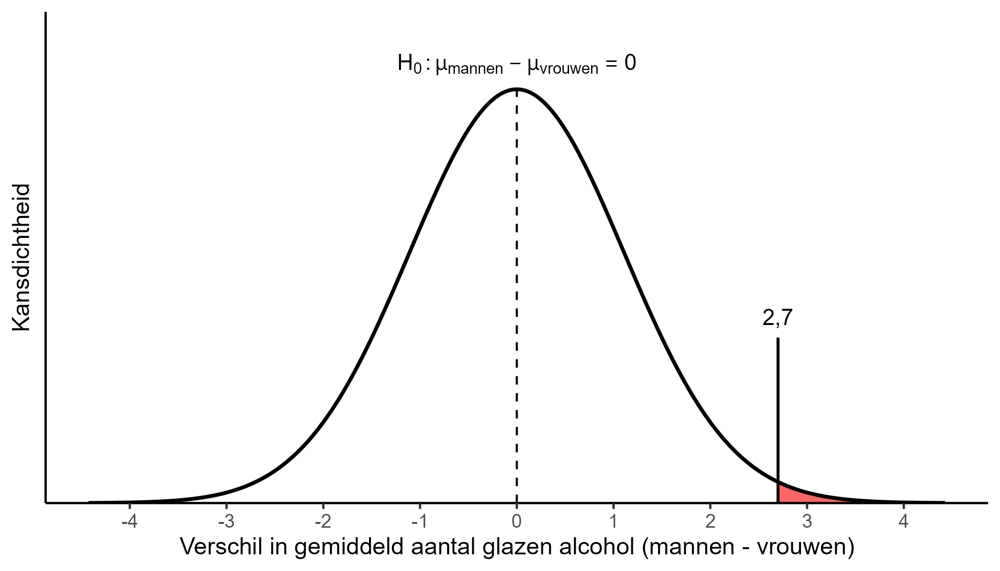



In het vorige deel hebben we kennis gemaakt met inferentiële statistiek. We bespraken hoe je op basis van een steekproef iets zinnigs kan zeggen over een bepaalde populatie en welke aspecten daarbij komen kijken. We keken daarbij vooral naar het schatten van een populatieparameter, wat bijvoorbeeld het proportie xtc-gebruik onder uitgaande jongeren is.

In statistisch onderzoek zijn we vaak geïnteresseerd in relaties tussen bepaalde dingen (zie ook de vragen bij [Data](002-01-data.qmd)), waarbij we doorgaans verwachtingen hebben over hoe die relatie werkt of in elkaar zit. Zoals bij [Relaties tussen variabelen](002-04-relatiesvariabelen.qmd), kunnen we data verzamelen over bepaalde kenmerken van personen en dan de relaties hiertussen onderzoeken. Dit zegt alleen iets over de personen in de dataset, maar nog niet de bredere populatie.

Om onze verwachtingen over relaties in de populatie te onderzoeken, maken we daarom gebruik van **hypothesetoetsing**. Hypotheses toetsen wil zeggen dat we een verwachting formuleren over hoe iets werkt in de populatie, dit vervolgens analyseren en dan uitspraken doen in hoeverre deze verwachting klopt. Daarbij houden we, net als bij de betrouwbaarheidsintervallen, rekening met hoe zeker we kunnen zijn over de juistheid van onze uitspraak.

In dit hoofdstuk gaan we hypothesetoetsing uitleggen aan de hand van een concreet voorbeeld. Er zijn grofweg twee manieren om een hypothese te toetsen. De klassieke methode is volgens het criterium van **statistische significantie**. Hierbij bepaal je voor een bepaalde grenswaarde (significantieniveau) of een hypothese kan worden verworpen. Hoewel deze methode (nog steeds) de standaard is in sociaalwetenschappelijk onderzoek, is er ook veel kritiek op. Hier komen we straks op terug. De andere methode is (surprise, surprise) het uitrekenen van een betrouwbaarheidsinterval. We zullen uitleggen waarom deze laatste methode onze voorkeur geniet.

Er komen bij het toetsen van hypotheses meerdere zaken kijken. De basics daarvan zullen we in deze cursus behandelen. Het is echter goed te realiseren dat de onderzoekspraktijk vaak nog wat complexer is en je na deze cursus dus nog niet uitgeleerd bent. Op een aantal van die zaken gaan we de komende hoofdstukken dieper in. Het is dus niet erg als je nog niet alles meteen begrijpt.

Ten slotte werken we het voorbeeld eerst uit middels een handmatige berekening. Dit helpt om de stappen in het hypothese toetsen beter te begrijpen. In de onderzoekspraktijk doen we uiteraard niet alles handmatig. Daarom volgt daarna vaak de berekening met de computer.

## Wie drinkt er meer?

Als voorbeeld kijken we naar het verschil tussen mannen en vrouwen in hoeveel glazen alcohol ze drinken tijdens een uitgaansdag. Hoewel er onder zowel mannen als vrouwen matige en stevige drinkers zitten, is het algemene beeld dat vooral de mannen tijdens het stappen de sluizen wel flink open kunnen zetten. We willen daarom onderzoeken of dit klopt.

Merk meteen op dat we hier twee verschillende meetniveaus met elkaar in verband brengen. We willen voor een nominale variabele (geslacht) weten wat het verschil is in gemiddeldes op een ratio variabele (aantal glazen alcohol).

Het onderzoeken van verschillen in drankconsumptie tussen mannen en vrouwen geeft een uitdaging. Stel dat we data verzamelen onder een groep van 40 uitgaanders bestaande uit 20 mannen en 20 vrouwen, en vinden dat mannen gemiddeld 11,4 glazen per uitgaansdag drinken en vrouwen 8,7. Op basis van de steekproef weten we dan dat mannen gemiddeld $11,4-8,7=2,7$ meer glazen alcohol drinken dan vrouwen. We zouden op basis hiervan kunnen stellen dat mannen gemiddeld meer drinken dan vrouwen.

Je weet echter uit de vorige hoofdstukken dat deze steekproef slechts één resultaat is van een (hypothetisch) oneindig aantal mogelijke steekproeven. In een andere steekproef kan het zijn dat we vinden dat vrouwen meer drinken dan mannen. Hoe kunnen we nu vaststellen dat ons gevonden verschil niet op toeval berust en we over het algemeen zullen vinden dat mannen meer drinken dan vrouwen?

Voor dit dilemma is de methode van hypothesetoetsing ontwikkeld. Het idee achter deze methode is in feite niet anders dan dat we gezien hebben bij het betrouwbaarheidsinterval. In plaats van de proportie xtc-gebruikers, nemen we nu het verschil tussen mannen en vrouwen in aantal glazen als onze te schatten populatieparameter en gaan we berekenen wat verdeling is van steekproefuitkomsten als we deze oneindig zouden herhalen. Hier komt de [steekproevenverdeling](003-01-steekproeven.qmd#sec-steekproefcentraallimiet) dus weer van pas!

Het aantal stappen bij hypothesetoetsing is uitgebreider dan bij het berekenen van een betrouwbaarheidsinterval. Die lopen we nu stap voor stap door.

### Statistische significantie

#### 1) Hypothese opstellen

De eerste stap is dat je jouw verwachting van de uitkomst zo expliciet mogelijk formuleert, dit wordt een **hypothese** genoemd. Hier volgt meteen een hersenkronkel. In standaard statistisch onderzoek toetsen we namelijk niet wat we verwachten, maar juist het tegenovergestelde daarvan! Deze tegenovergestelde verwachting wordt de **nulhypothese** genoemd. *Deze nulhypothese wordt vervolgens wel of niet verworpen, dit is in feite het centrale doel van wetenschappelijk onderzoek verrichten*. De reden waarom we dit zo doen, komen we op terug bij HYPOTHESE OPSTELLEN. Daar bespreken we ook uitgebreider waar je op moet letten bij het formuleren van een nulhypothese.

Onze verwachting bij dit voorbeeld is dat mannen gemiddeld meer glazen alcohol drinken dan vrouwen op een uitgaansdag. We gebruiken vaak statistische notatie dit expliciet te maken:

$$\mu_1>\mu_2 $$

Dit betekent officieel dat het gemiddelde in de populatie van de eerste groep ($\mu_1$) groter is dan het gemiddelde van de populatie van de tweede groep ($\mu_2$). Oftewel, het gemiddelde aantal glazen alcohol onder mannen is hoger dan het gemiddelde aantal glazen alcohol onder vrouwen.

Draaien we dit om voor het formuleren van de nulhypothese, dan krijgen we:

$$\mu_1\leq\mu_2$$

Dit lezen we als: het populatiegemiddelde aantal glazen alcohol onder mannen ($\mu_1$) is *kleiner of gelijk* *aan* het populatiegemiddelde aantal glazen alcohol onder vrouwen ($\mu_2$).[^004-01-onafhankelijkegroepen-1]

[^004-01-onafhankelijkegroepen-1]: Let op dat we het in dit geval hebben over 'kleiner of gelijk aan' ($\leq$) en niet 'kleiner dan' (\<). Als er namelijk geen verschil is in gemiddeld aantal glazen alcohol tussen mannen en vrouwen ($\mu_1=\mu_2$), betekent dit ook een ander resultaat dan wat je verwacht onder de nulhypothese.

We zouden dit ook als volgt kunnen noteren:

$$\mu_2-\mu_1\ \geq 0$$

Oftewel, onder de nulhypothese verwachten we dat verschil tussen $\mu_1$ en $\mu_2$ groter of gelijk is aan nul. Bij de nulhypothese verwacht je vaak geen verschil of in een andere richting dan je zou denken. Daarom wordt het de nulhypothese genoemd (nul verschil, nul samenhang, nul effect, etc.) 🤓.

#### 2) Bepalen significantieniveau

Het **significantieniveau** is de grenswaarde waarbij we een nulhypothese verwerpen. Als de overschrijdingskans (p-waarde) kleiner is dan deze grenswaarde, verwerpen we de nulhypothese. Hier komen we bij de volgende stappen op terug. Gebruikelijke significantieniveaus in de statistiek zijn 0,01 (1%), 0,05 (5%) en 0,1 (10%). Meestal gaan we standaard uit van een significantieniveau van 0,05 en doen dit bij dit voorbeeld ook.

#### 3) Overschrijdingskans

De **overschrijdingskans**, ook wel p-waarde genoemd of simpelweg $p$ , speelt een centrale rol in het toetsen van hypotheses. Het geeft aan hoe waarschijnlijk het resultaat verkregen uit onze steekproef is, aangenomen dat de nulhypothese waar is.[^004-01-onafhankelijkegroepen-2]

[^004-01-onafhankelijkegroepen-2]: 'Resultaat' verwijst hier naar de populatieparameter waarin we geïnteresseerd zijn: het gemiddelde verschil tussen mannen en vrouwen in drankconsumptie.

Je zult inmiddels wel denken: "waar zijn we nu weer aanbeland"?

{width="340"}

Laten we het laag voor laag afpellen.

Bij het onderzoeken van hypotheses kijken we zoals gesteld naar de nulhypothese. Dit heeft ermee te maken dat we vanuit wetenschapsfilosofisch oogpunt aannemen iets nooit helemaal zeker te weten. Het is daarom makkelijker om het onwaarschijnlijke van wat we verwachten (de nulhypothese) te verwerpen, en er dan vanuit gaan dat het waarschijnlijke 'voorlopig' waar is. Dit staat bekend als het **falsificatieprincipe** van Karl Popper.

In de praktijk betekent dit dat de nulhypothese ons vertrekpunt vormt. Vanuit de nulhypothese is de verwachting doorgaans dat er geen verschil is tussen groepen, oftewel het verschil is nul.[^004-01-onafhankelijkegroepen-3] Onze 'ware' populatiewaarde, gegeven de nulhypothese, is daarom nul. We maken een denkbeeldige steekproevenverdeling van mogelijke steekproefuitkomsten die hierbij past (zie ook [Steekproevenverdeling](003-01-steekproeven.qmd#sec-steekproefcentraallimiet) en [Betrouwbaarheidsinterval](003-02-betrouwbaarheidsinterval.qmd)). Dit noemen we ook wel de H~0~-verdeling of de verdeling onder de nulhypothese.

[^004-01-onafhankelijkegroepen-3]: Je zult zien dat wat we verwachten voor de nulhypothese varieert naar wat voor soort populatieparameter we proberen te schatten. Dit kan de ene keer een verschil in gemiddeldes zijn, maar ook een verschil in percentages of een correlatie. Dit hangt af van de onderzoeksvraag en het meetniveau van de variabelen.



Die H~0~-verdeling staat hierboven weergeven. De verdeling geeft een indicatie van hoe waarschijnlijk een bepaalde steekproefuitkomst is onder H~0~. Je kunt bijvoorbeeld zien dat een gemiddeld verschil van drie glazen zeer onwaarschijnlijk is: het ligt ver van de midden van de verdeling. Hoe groter de afstand tot H~0~, hoe eerder we de nulhypothese zullen verwerpen.

We kunnen nu de kans berekenen dat een bepaalde steekproefuitkomst voorkomt binnen deze verdeling: de overschrijdingskans! We werken immers met een normaalverdeling en kunnen via de empirische regel nagaan wat de kans op een bepaalde uitkomst is (zie [Normale verdeling](002-03-centrum-en-spreidingsmaten.qmd#sec-normaleverdeling)).

We generen eerst de data die hoort bij ons voorbeeld. We hebben ons onderzoek verricht onder 20 mannen en 20 vrouwen, met respectievelijke gemiddeldes van 11,4 en 8,7 glazen alcohol. Voor het gemak gaan we er even vanuit dat de standaarddeviatie $s$ binnen beide groepen 3,5 is.

```{r}
set.seed(010)

# Trekt n respondenten en schaalt ze zodat gemiddelde en sd exact kloppen
genereer_groep <- function(n, gemiddelde, s) {
  rnorm(n) |> scale() |> as.vector() * s + gemiddelde
}

voorbeeld_alcohol <- data.frame(
  geslacht                     =  factor(rep(c("man", "vrouw"), each = 20)),
  glazen_alcohol_uitgaansdag   = 
    c(genereer_groep(20, 11.4, 3.5), genereer_groep(20, 8.7, 3.5))
)
```

Vervolgens berekenen we de overschrijdingskans die bij deze steekproef hoort.

```{r}
# toets uitvoeren om overschrijdingskans te berekenen
t.test(glazen_alcohol_uitgaansdag ~ geslacht, # variabelen bepalen
       alternative = "greater", # eenzijdig toetsen (groter dan)
       data = voorbeeld_alcohol, # data invoeren
       var.equal = TRUE) # uitgaande van gelijke variantie
```

Boem! De overschrijdingskans is afgerond 0,010 (zie p-value).



We volgen zelfde principe als bij de steekproevenverdeling.

- jongens-meiden glazen alcohol

- stappen in hypothese toetsen (t-toets)

  - met hand en via computer

  - (t-verdeling, nulhypothese)

  - nominaal vs. kwantitatief.

- Andere uitleg met meer details volgt in andere hoofdstukken.
