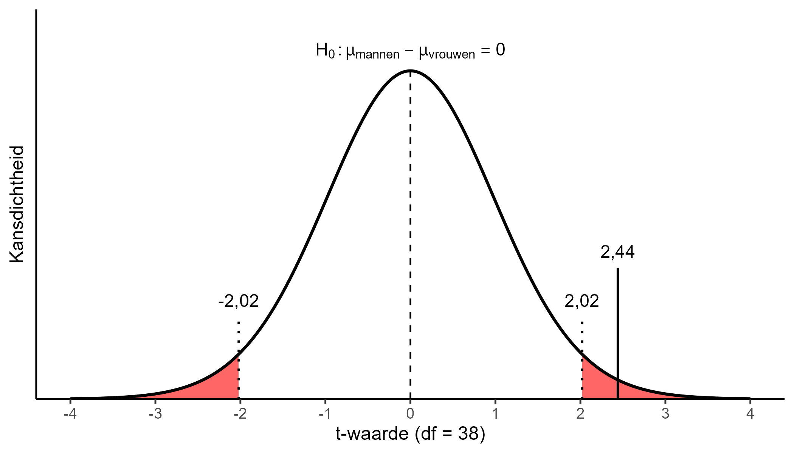
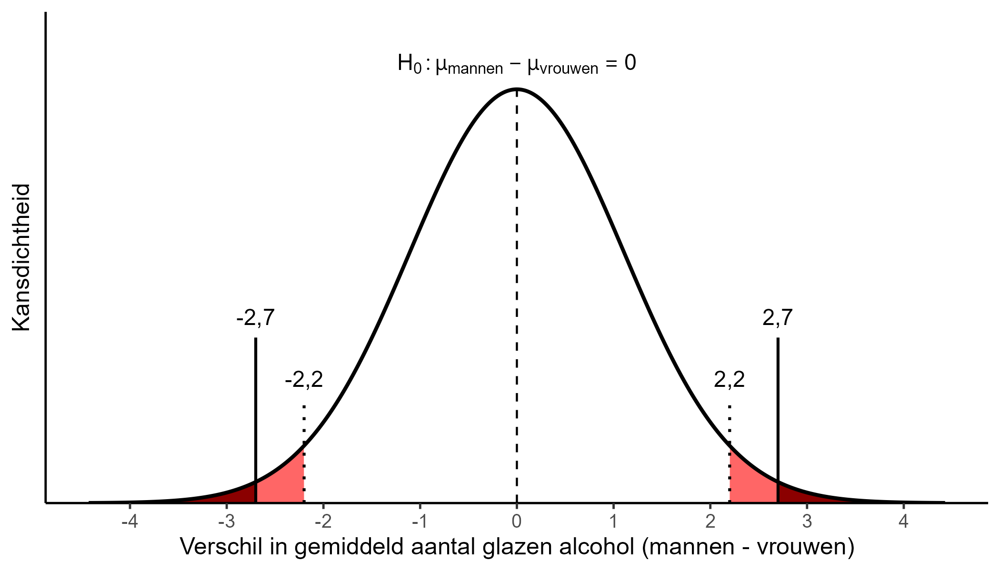
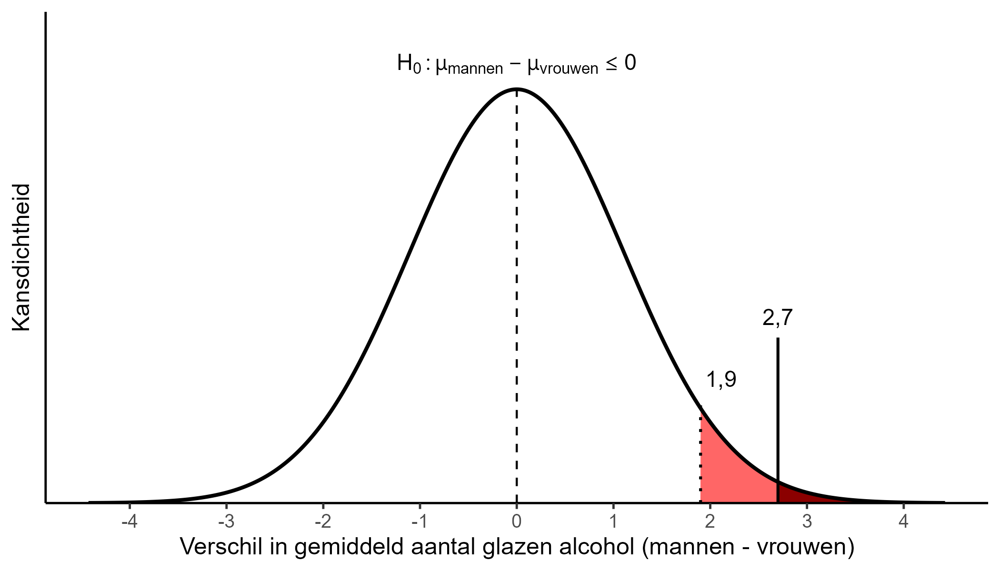



In het vorige hoofdstuk heb je geleerd wat hypothese toetsen inhoudt en welke stappen je daarbij moet nemen. Als je dit voor deze eerste keer leert, kan het behoorlijk uitdagend zijn om het allemaal te verwerken. Je zult echter zien dat naarmate je het vaker oefent en verschillende bhi's hebt berekend, je het principe ervan beter zult gaan begrijpen. Oefening baart kunst (OBK)!

We hebben tot nu een paar bochten afgesneden. Zoals gesignaleerd in het vorige hoofdstuk, zijn er bij hypothese toetsen meerdere aspecten waar je rekening mee moet houden. Een aantal van die aspecten behandelen we hier. Daarna heb je, als het goed is, een aardig overzicht van wat er allemaal bij hypothesetoetsen komt kijken. We gaan in op de volgende vier zaken: 1) de t-verdeling 2) het formuleren van hypotheses 3) eenzijdig en tweezijdig toetsen en 4) type-I en type-II fouten.

## T-verdeling

Zoals je inmiddels weet, gebeurt het berekenen van dingen zoals de overschrijdingskans en een bhi op basis van de normale verdeling. Tot nu toe hebben we aangenomen dat de [normale verdeling](002-03-centrum-en-spreidingsmaten.qmd#sec-normaleverdeling) altijd hetzelfde is, waarbij de distributie van waarden de empirische regel bolgt. Dit houdt in dat binnen een xx aantal standaarddeviaties van het gemiddelde xx% van alle waarden ligt, afhankelijk van hoeveel standaarddeviaties je neemt. Deze vaste vorm staat ook wel bekend als de standaardnormale verdeling of z-verdeling en geldt over het algemeen voor populatiedata.

Het blijkt echter dat de standaardnormale verdeling niet altijd even goed van toepassing is. Met name voor kleinere steekproeven vinden we dat de normale verdeling een andere vorm heeft dan *standaard*normale verdeling. In deze video wordt uitgelegd hoe dat precies werkt:



We moeten dus rekening houden met de t-verdeling in ons onderzoek, omdat deze afhankelijk van de steekproefgrootte een iets andere vorm heeft dan de z-verdeling. Dit is vooral bij kleinere steekproeven relevant (onder de 30 respondenten).

Bij het hypothese toetsen via statistische significantie zijn er in essentie twee relevante t-waardes: de kritieke grenswaarde ($t_k$) en toetsingsgrootheid ($t_g$). De eerstgenoemde is de grenswaarde waarbij we de nulhypothese verwerpen. De $t_k$ is afhankelijk van het gekozen significantieniveau (bijv. 0,01; 0,05 of 0,1) en het aantal respondenten in de steekproef minus het aantal geschatte populatieparameters bij een t-toets (oftewel: het aantal vrijheidsgraden).

Bij het [voorbeeld](004-01-onafhankelijkegroepen.qmd#sec-statistischesignificantie) uit het vorige hoofdstuk zagen we dat de nulhypothese werd verworpen wanneer het gemiddelde verschil in aantal glazen alcohol groter was dan 2,2 of kleiner dan -2,2. Deze waarden hebben we kunnen herleiden uit de $t_k$ . Als je voor dit voorbeeld de $t_k$ zou opzoeken in de t-tabel ([link](https://statisticsfundamentals.com/tables/t-distribution-table/)), dan zou je uitkomen op $t_k=2,024$.[^004-02-aspectenhypo-1] [^004-02-aspectenhypo-2]

[^004-02-aspectenhypo-1]: Op basis van de volgende gegevens:

    - aantal vrijheidsgraden: $n-2$ in dit geval, dus $40-2=38$ .
    - gekozen significantieniveau: 5%
    - Tweezijdig toetsen (zie verderop dit hoofdstuk)

[^004-02-aspectenhypo-2]: Het aantal vrijheidsgraden bij een t-toets voor onafhankelijke groepen en ongelijke varianties wordt normaliter via een ingewikkelde formule berekend. Omdat bij dit voorbeeld de varianties gelijk zijn alsmede het aantal respondenten, hoeven we alleen $n-2$ te doen om het aantal vrijheidsgraden te verkrijgen.

De toetsingsgrootheid $t_g$ is de t-waarde die correspondeert met het steekproefresultaat en waar deze zich bevindt onder de H~0~-verdeling. Elke toets kent zijn eigen formule om dit te berekenen. Bij de R-output uit het [voorbeeld](004-01-onafhankelijkegroepen.qmd#sec-statistischesignificantie) kun je zien dat (afgerond) $t_g=2,440$. Deze waarde komt dus overeen met gevonden verschil in gemiddeldes van 2,7 glazen.

In de figuur hieronder wordt bovenstaande gevisualiseerd. Je ziet dus dat dit in feite niet anders is dan wat we in het vorige hoofdstuk hebben gezien. De t-waardes worden gebruikt om de bijbehorende grens van het significantieniveau en de overschrijdingskans te bepalen.



### Bhi op basis van t-verdeling

We maken het ons iets makkelijker in deze cursus door voornamelijk te kijken naar bhi's. Daarvoor hebben we alleen de kritieke grenswaarde nodig en niet de toetsingsgrootheid. De laatste is alleen van toepassing bij de methode van statistische significantie.

We doorlopen nu nogmaals het voorbeeld uit het vorige hoofdstuk, maar nu met 15 mannen en 15 vrouwen. We berekenen handmatig het bhi volgens de t-verdeling. Dan krijg je een idee hoe een bhi voor een t-toets voor onafhankelijke groepen tot stand komt. De formule is als volgt:

$$
bhi =(\bar{x}_1 - \bar{x}_2) \pm t_k \sqrt{\frac{s_1^2}{n_1} + \frac{s_2^2}{n_2}}
$$

Deze formule is niet veel anders dan bij het [Betrouwbaarheidsinterval](003-02-betrouwbaarheidsinterval.qmd). Hier neem je het gemiddelde van mannen $\bar{x}_1$ minus het gemiddelde van vrouwen $\bar{x}_2$. Het gedeelte achter de $\pm$ bereken je wederom apart. Daarvoor zoek je de bijbehorende $t_k$. Daarvoor kunnen we weer kijken in de t-tabel ([link](https://statisticsfundamentals.com/tables/t-distribution-table/)): $t_k=2,048$.[^004-02-aspectenhypo-3] Het laatste deel $\sqrt{\frac{s_1^2}{n_1} + \frac{s_2^2}{n_2}}$ is berekening van de standaardfout $s.e.$ voor deze toets.[^004-02-aspectenhypo-4] Net zoals bij [Betrouwbaarheidsinterval](003-02-betrouwbaarheidsinterval.qmd) kunnen we dit weer in R berekenen.

[^004-02-aspectenhypo-3]: Op basis van de volgende gegevens:

    - aantal vrijheidsgraden: $n-2$ , dus $30-2=28$ .
    - gekozen significantieniveau: 5%
    - Tweezijdig toetsen

[^004-02-aspectenhypo-4]: $s.e.$ is een meer algemene notatie voor de standaardfout (*standard error*).

```{r}
# verschil in gemiddeldes
11.4-8.7
```

```{r}
# gedeelte achter +-
2.048*sqrt(3.5^2/15+3.5^2/15)
```

```{r}
# 95%-bhi berekenen
2.7-2.617
2.7+2.617
```

Je ziet dus dat het bhi in dit geval $[0,08; 5,32]$ bedraagt. Dit is een breder bhi dan in het vorige hoofdstuk ($[0,46; 4,94]$). Als je naar de formule kijkt, kun je zien dat een kleinere $n$ leidt tot een grotere standaardfout $s.e.$ *Daar komt nu nog bovenop dat* *we middels de t-verdeling (de kritieke grenswaarde* $t_k$) *corrigeren voor kleinere steekproeven.* Bij grotere steekproeven is de t-verdeling nagenoeg gelijk aan de z-verdeling (zie het youtube filmpje hierboven).

Interessant is overigens dat de ondergrens van het huidige bhi $[0,08; 5,32]$ net boven de nul ligt. Op basis hiervan zouden we de nulhypothese van geen verschil tussen mannen en vrouwen verwerpen. In het geval dat de ondergrens net onder 0 zou liggen, zouden we dat niet doen. Het zou echter aan de interpretatie van de mogelijke populatieparameter niet zoveel veranderen: het gemiddelde verschil in glazen alcohol ligt ongeveer ergens tussen de 0 en 5. Je ziet hier dus al hoe je tot andere conclusies komt wanneer je de bhi-methode vergelijkt met de methode van alleen statistische significantie.

R houdt verder automatisch rekening met de t-verdeling bij het uitvoeren van toets. We kunnen bovenstaande berekening ook 'computermatig' met R doen.

```{r}
set.seed(010)

# nieuwe dataset met totaal 30 respondenten
voorbeeld_alcohol_2 <- data.frame(
  geslacht                     =  factor(rep(c("man", "vrouw"), each = 15)), # variabele mannen en vrouwen aanmaken, nu met 15 respondenten
  glazen_alcohol_uitgaansdag   = 
    c(genereer_groep(15, 11.4, 3.5), genereer_groep(15, 8.7, 3.5)) # 15 respondenten per geslacht, met bijbehorende gemiddeldes en sd
)
```

```{r}
# t-toets uitvoeren voor bhi
t.test(glazen_alcohol_uitgaansdag ~ geslacht,
       data = voorbeeld_alcohol_2) 
```

Het bhi is hier, op wat miniscule afrondingsverschillen na, hetzelfde als bij de handmatige berekening. Dit is dus een stukje sneller dan altijd alles met de hand moeten doen.

Merk tenslotte op dat de formules van bhi's voor proporties en gemiddeldes bij [Betrouwbaarheidsinterval](003-02-betrouwbaarheidsinterval.qmd) niet helemaal correct waren voor steekproeven. Daar gingen we nog van z-waardes uit i.p.v. t-waardes. De 'juiste' formules kun je vinden in het [Formuleblad](formuleblad.qmd). Daarmee zullen we ook werken in de practica.

## Hypotheses formuleren {#sec-hypoformuleren}

In het vorige hoofdstuk bij [Hypothese opstellen](004-01-onafhankelijkegroepen.qmd#sec-opstellenhypo) werd genoemd dat het relevant is om een hypothese zo exact mogelijk te formuleren. Dit omdat een hypothese invulling geeft aan *wat* we willen onderzoeken en *hoe* wat dat willen meten (lees: operationaliseren). Daarom hanteren we volgende regels bij het opstellen van een hypothese:

1.  De richting van het verband moet duidelijk zijn

Hypotheses kunnen in principe tweezijdig of eenzijdig zijn (zie ook VOLGENDE SECTIE). Tweezijdig betekent dat we geen specifieke verwachting hebben over de richting van het verband. Bijvoorbeeld dat er geen verschil is tussen mannen en vrouwen in hoeveel glazen alcohol ze gemiddeld drinken (de nulhypothese). De originele verwachting is dan dat mannen meer drinken dan vrouwen, maar ook dat vrouwen meer drinken dan mannen. Je verwacht alleen een bepaald verschil te vinden.

Bij een eenzijdige hypothese maak je de richting expliciet. Dan zeg je bijvoorbeeld dat je verwacht dat mannen meer drinken vrouwen (en niet andersom). De nulhypothese is dan dat dan het gemiddelde aantal glazen dat mannen drinken *kleiner of gelijk is* aan het gemiddelde aantal glazen dat vrouwen drinken op een uitgaansdag.

2.  De nulhypothese moet het tegenovergestelde zijn van de originele verwachting (en elkaar uitsluiten)

Als je de nulhypothese verwerpt, ga je er 'voorlopig' vanuit dat je originele verwachting waar is. Daarvoor is het wel belangrijk dat die nulhypothese een spiegel is van de originele verwachting, dat ze tegenovergesteldes van elkaar zijn. Anders sluiten ze elkaar niet uit.

Het voorbeeld hierboven van de eenzijdige hypothese bevestigt toont waarom. Als je verwacht dat mannen meer drinken dan vrouwen, dan verwacht je dat het verschil groter is dan nul met een hoger gemiddelde bij de mannen. Het tegenovergestelde (de nulhypothese) is dan dat het verschil tussen mannen en vrouwen nul is of lager bij de mannen, vandaar 'kleiner of gelijk aan'.

3.  Gebruik de juiste statistische notatie

Zoals je al eerder zag, gebruiken we statistische notatie om onze verwachtingen formeel uit te drukken. Zo verwachten we bij een tweezijdige hypothese dat $\mu_1 \ne \mu_2$ , wat betekent dat het gemiddelde in de populatie van de eerste groep ($\mu_1$) niet gelijk is aan het gemiddelde van de populatie van de tweede groep ($\mu_2$). De nulhypothese is dan $\mu_1 =\mu_2$, oftewel dat de populatiegemiddeldes wel gelijk zijn aan elkaar.

Bij een eenzijdige hypothese verwachten we bijvoorbeeld dat het gemiddelde van mannen $\mu_1$ groter is dan dat van vrouwen $\mu_2$. Dit noteren we als $\mu_1 > \mu_2$. De nulhypothese is hier dan $\mu_1 \le \mu_2$ : het het gemiddelde van mannen $\mu_1$ is kleiner of gelijk aan dat van vrouwen $\mu_2$.

4.  Begrippen moet helder zijn en geformuleerd op operationaliseerbaar niveau

De hypothese moet duidelijk maken wat je precies onderzoekt en hoe dat is gemeten. Neem als voorbeeld: "de ene groep drinkt meer dan de andere groep". Deze hypothese is te vaag. Het zegt niks over welke groepen het gaat, wat voor drank en in welke eenheden wordt gemeten. Ook de formulering "mannen drinken meer dan vrouwen" is niet voldoende. Dit zegt nog weinig over welke drankconsumptie we precies onderzoeken. Bovendien zijn we bij een t-toets expliciet gemiddeldes aan het vergelijken. Een juiste formulering van de nulhypothese zou zijn (bij een tweezijdige hypothese):

> het gemiddelde aantal glazen alcohol gedronken door mannen is gelijk aan het gemiddelde aantal glazen alcohol gedronken door vrouwen op een uitgaansdag (onder de populatie alcoholgebruikers)

Dit is een wat langdradige formulering, maar beschrijft wel zo exact mogelijk wat je probeert te onderzoeken. Het geeft ook meer informatie over de context (op een uitgaansdag, alleen voor mensen die überhaupt drinken).[^004-02-aspectenhypo-5]

[^004-02-aspectenhypo-5]: In de lopende tekst van dit boek omschrijven we de verbanden/hypotheses niet altijd even precies. Dit doen we om de tekst leesbaar te houden. Aan het begin van een onderzoek is het belangrijk dat je de hypotheses altijd zo precies mogelijk formuleert.

5.  Het moet duidelijk zijn om welke toets het gaat.

Tot nu toe hebben we alleen een t-toets voor onafhankelijke groepen behandeld. Daarin vergelijken we de gemiddeldes van twee groepen (nominale variabele) op één kwantitatieve variabele met elkaar: $\mu_1 =\mu_2$. In de komende hoofdstukken gaan we nog meer toetsen behandelen: t-toets voor afhankelijke groepen, chi-kwadraat, en correlatie. Uit de formulering van de hypotheses en statistische notatie moet volgen om wat voor soort toets het steeds gaat. Hoe je dat per toets doet, wordt bij de voorbeelden uitgelegd.

## Tweezijdig/eenzijdig toetsen

Hierboven is al genoemd dat er twee soorten hypotheses zijn: hypotheses zonder een specifieke richting (**tweezijdig**) en hypotheses waarin het verband een specifieke richting heeft (**eenzijdig**). Het verschil tussen tweezijdig en eenzijdig is niet alleen relevant in hoe we de hypothese formuleren, maar ook voor hoe we deze toetsen uitvoeren. Het heeft namelijk invloed op hoe de overschrijdingskans wordt berekend.

Wanneer we een tweezijdige hypothese hebben, berekenen we de kans op het verkrijgen van een steekproefresultaat minstens zo extreem *in beide richtingen* van de verdeling (onder de H~0~ uiteraard). Teruggaand naar het [voorbeeld](004-01-onafhankelijkegroepen.qmd#sec-statistischesignificantie) uit het vorige hoofdstuk, betekent dit dat we de kans berekenen op het verkrijgen van een verschil in gemiddeldes van 2,7 of hoger of -2,7 of lager. Dat is hieronder verbeeld.



Het donkere gedeelte onder de normale verdeling vertegenwoordigt de overschrijdingskans $p=0,019$. Ook al geeft het steekproefresultaat ons een verschil van 2,7 (de daadwerkelijke uitkomst), omdat we een tweezijdige verwachting hadden moeten we rekening houden met dat de uitkomst aan beide kanten van de verdeling had kunnen vallen.

Stel dat we een eenzijdige verwachting hadden: mannen drinken meer dan vrouwen. En dat de uitkomst van de steekproef nog steeds hetzelfde was (een verschil van 2,7). In dat geval berekenen we de overschrijdingskans anders, omdat deze nu kans vertegenwoordigt op het verkrijgen van een steekproefresultaat minstens zo extreem *aan rechterzijde* de verdeling (onder de H~0~). Bij dit voorbeeld gaat het om de rechterzijde, omdat we oorspronkelijk een *positief* verschil verwachten in gemiddeldes: dat van mannen $\mu_1$ is hoger dan dat van vrouwen $\mu_2$.[^004-02-aspectenhypo-6] De grafische weergave is dan als volgt.

[^004-02-aspectenhypo-6]: De H~0~ is hier dan $\mu_1 \le \mu_2$ (zie ook @sec-hypoformuleren).



Er zijn nu een aantal dingen veranderd. Omdat de overschrijdingskans nog maar voor één kant van de H~0~-verdeling geldt, is deze de helft van de tweezijdige overschrijdingskans geworden. Dit betekent dat $p=0,019/2=0,0095$ . Ook is de kritieke grenswaarde verschoven. Je toetst nog steeds bij een significantieniveau van 0,05. Een eenzijdige hypothese brengt echter met zich mee dat je de nulhypothese alleen verwerpt als de uitkomst in het gebied valt waar je dit verwacht, in dit voorbeeld de rechterzijde. Bij tweezijdig toetsen is de 5% verdeeld over beiden kanten van de verdeling (2,5% links en 2,5% rechts). Bij eenzijdig toetsen wordt alle 5% als het ware aan de rechterkant geplaatst. Daardoor verandert de kritieke grenswaarde, deze correspondeert nu teruggerekend met 1,9 glazen alcohol.

De keuze voor eenzijdig of tweezijdig toetsen kan gevolgen hebben voor het vaststellen van statistische significantie, en uiteindelijk jouw conclusies. Stel je had een steekproef getrokken waarbij het verschil in gemiddeldes tussen mannen en vrouwen 2,0 glazen is. Bij een tweezijdige hypothese zou dit resultaat zich niet in het H~0~-verwerpingsgebied bevinden, maar bij eenzijdig toetsen wel. In het eerste geval zou je de nulhypothese dus niet verwerpen, in het tweede geval wel.[^004-02-aspectenhypo-7] Daarom is het belangrijk dat je *vooraf* aan een analyse duidelijk bent over de richting van je hypothese en gekozen significantieniveau, zodat je niet achteraf de resultaten gaat aanpassen om een statistisch significant resultaat te krijgen.[^004-02-aspectenhypo-8]

[^004-02-aspectenhypo-7]: Bij een steekproefresultaat van bijvoorbeeld -2,5 glazen zou dit andersom zijn. Hopelijk kun je al bedenken waarom.

[^004-02-aspectenhypo-8]: Zulke praktijken worden ook wel *p-hacking* genoemd.

De uitleg hierboven heeft zich toegespitst op de methode van statistische significantie. Bij bhi's is het tevens relevant of je een eenzijdige of tweezijdige verwachting hebt, omdat de berekening van het bhi daar in principe op moet worden aangepast. In de praktijk gaan we bij bhi's echter bijna altijd uit van een tweezijdige toets, ook al hebben we een eenzijdige hypothese. Dat is niet helemaal statistisch correct, maar meestal zijn we geïnteresseerd in zowel de ondergrens als de bovengrens van het bhi.[^004-02-aspectenhypo-9] Dit betekent dat we soms wat conservatiever toetsen op het verwerpen van de nulhypothese dan nodig, maar better be safe than sorry. En het houdt de interpretatie ook eenvoudiger (weer een win voor het bhi t.o.v. statistische significantie!).

[^004-02-aspectenhypo-9]: Bij een eenzijdige toets met een bhi krijg je namelijk alleen een vaste onder- of bovengrens, afhankelijk van de richting van je hypothese.

## Type-I en type-II fouten

Als laatste kijken we in dit hoofdstuk naar type-I en type-II fouten. Dit zijn fouten die kunnen voorkomen bij statistisch onderzoek waardoor we de verkeerde conclusie trekken over de nulhypothese.

Een type-I fout houdt in dat we de nulhypothese verwerpen terwijl deze eigenlijk waar is. Dit gebeurt aan de hand van statistisch significant resultaat. Stel we doen een hypothesetoets bij een significantieniveau van 5% en vinden dat de toets significant is en verwerpen vervolgens de nulhypothese. Onze redenering is doorgaans dat het onwaarschijnlijk is om een waarde zo extreem (kans lager dan 5%) te vinden onder de H~0~-verdeling, en dat we daarom de nulhypothese kunnen verwerpen. Echter, het kan zo zijn dat we een willekeurige steekproef hebben getrokken waarvan de uitkomst toevallig heel ver van het midden van de H~0~-verdeling ligt (zie ook weer [Steekproevenverdeling](003-01-steekproeven.qmd#sec-steekproefcentraallimiet)). Dit weerspiegelt dan geen verschil in de populatie, maar eerder een steekproef met veel afwijkende waarden.

Elk nadeel hebse voordeel, in ieder geval bij een type-I fout. We weten namelijk hoe groot de kans is op het maken van deze fout, gegeven dat de nulhypothese waar is. Die is namelijk hetzelfde als het significantieniveau $\alpha$. Dat is namelijk de grens waarbij een hypothese verwerpen. Dit betekent dat een lager significantieniveau, zoals 0,01 of zelfs 0,001, het risico op een type-I fout verkleint. Met een lager significantieniveau stellen we wel strengere eisen aan wanneer een nulhypothese kan worden verworpen. Hier is dus een trade-off.

Een type–II fout is juist wanneer de nulhypothese niet verwerpen, terwijl dit wel zou moeten. De nulhypothese is in dit geval eigenlijk niet waar. Hier zijn twee oorzaken voor die vaak met elkaar samenhangen. Een is dat om een heel klein verschil of effect gaat, wat middels hypothese toetsen moeilijk is waar te nemen. Bijvoorbeeld als het verschil in glazen alcohol tussen mannen en vrouwen in de populatie 0,2 is. We zullen dan relatief veel steekproeven trekken die nul verschil vinden. De tweede oorzaak is een te laag aantal respondenten om een verschil goed waar te nemen. Zoals je in eerdere voorbeelden hebt gezien, leidt een lagere $n$ tot bijvoorbeeld een breder bhi of een grotere kritieke grenswaarde. De kans dat we de nulhypothese niet verwerpen terwijl dat wel zou moeten neemt dan toe, bijvoorbeeld omdat nul zich in het bhi bevindt terwijl de populatieparameter niet nul is.

In tegenoverstelling tot een type-I fout weten we niet hoe groot de kans is op een type-II fout. We weten alleen dat risico kleiner wordt naarmate we meer data verzamelen.

Het voorkomen van deze fouten wijst ons erop dat we resultaten van een statistisch onderzoek nooit als definitief moeten beschouwen. Het kan zijn dat we de nulhypothese onterecht verwerpen (type-I fout), maar ook andersom dat we nulhypothese niet verwerpen terwijl deze eigenlijk waar is (type-II fout). Dit impliceert verder dat het verwerpen van de nulhypothese niet automatisch betekent dat het tegenovergestelde waar is, en dat het niet verwerpen van de nulhypothese betekent dat de nulhypothese waar is of 'bewezen'. De statistische tools die je hier leert zijn daarmee slechts hulpmiddelen in het ontdekken van de waarheid, maar geven ons nooit 100% uitsluitsel.

## Samenvatting 

Dit hoofdstuk heeft diverse aspecten behandeld die relevant zijn bij toetsen van hypotheses, zowel voor de methode van statistische significantie als bhi's. De belangrijkste take-aways zijn:

- Bij het berekenen van een toetsingsresultaat moeten we rekening houden met de t-verdeling. Dit kan bij handmatige berekeningen worden opgezocht in de t-tabel, bij computermatige berekeningen houdt R hier automatisch rekening mee

- Het formuleren van hypotheses vraagt om precisie m.b.t. wat we onderzoeken en hoe we dat meten

- Het is voorafgaand aan analyse belangrijk om hypotheses duidelijk eenzijdig of tweezijdig te formuleren, dit heeft gevolgen voor hoe we de toets uitvoeren. Bij bhi's gaan we hier wat soepeler mee om.

- Bij hypothesetoetsing kunnen zowel type-I als type-II fouten optreden. Daarom moeten we resultaten altijd voorzichtig interpreteren, ook vanwege beperkingen die we in de rest van de cursus behandelen.
