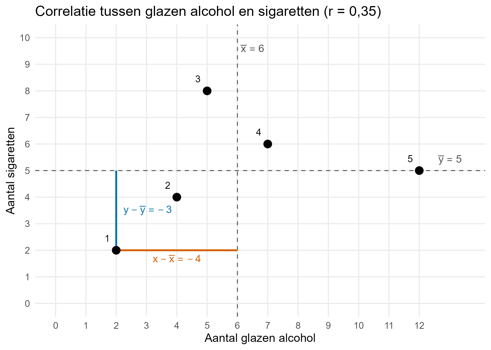



We hebben al aardig wat verschillende relaties (kwali vs. kwali, kwali vs. kwanti) en toetsen (bhi's, Bayes factor, t-toetsen, Chi^2^) behandeld. Wat nog mist in ons rijtje, is hoe we een relatie tussen twee kwantitatieve variabelen kunnen onderzoeken. Dit doen we middels een **correlatie**.

Correlaties zullen jullie niet onbekend klinken. In het dagelijks leven komen we vaak correlaties tegen in het nieuws of op de socials, waar de term meer algemeen wordt gebruikt om relaties tussen bepaalde dingen aan te duiden. Er zijn zelfs [websites](https://tylervigen.com/spurious-correlations) waar schijncorrelaties worden bijgehouden: correlaties die statistisch sterk zijn maar geen inhoudelijke betekenis hebben.

In de criminologie zijn we ook geïnteresseerd in correlaties. Bijvoorbeeld tussen leeftijd en hoeveel criminaliteit men pleegt (de age-crime curve) of tussen hoe vaak men op stap gaat en hoeveel er gedronken wordt.

We behandelen een correlatie hier dus in engere zin: als de sterkte van een verband tussen **twee kwantitatieve variabelen**. We gaan in op de volgende aspecten rondom een correlatie: hoe je deze berekent, statistische significantie en Bayes factor, een betrouwbaarheidsinterval, de assumpties en waar je op moet letten bij de interpretatie. Belangrijk om te onthouden is dat een correlatie een populatieparameter is, net als andere populatieparameters die we hebben behandeld (proportie, gemiddelde, verschil in gemiddeldes, etc.). We willen dus schatten hoe sterk een verband tussen twee zaken is binnen een populatie.

We richtingen ons hier op de **Pearson** **correlatie**, die we aanduiden met de letter $r$ .[^005-03-correlatie-1] Er bestaat ook nog de Spearman correlatie $\rho$ die gebruiken als minstens één van de twee variabelen een ordinaal meetniveau heeft, maar die laten we buiten beschouwing.

[^005-03-correlatie-1]: Footnote Pearson

## Pils en paffen

Voor het voorbeeld grijpen we terug op wat we eerder behandeld hebben: [de relatie](002-04-relatiesvariabelen.qmd#sec-nominaalordinaal#sec-kwantikwanti) tussen het aantal genuttigde glazen alcohol en aantal sigaretten op een uitgaansdag.[^005-03-correlatie-2] We kunnen verwachten dat uitgaanders die meer drinken ook meer zullen roken, omdat drinken de trek in een sigaret vergroot voor veel mensen. Toch zullen we dit tweezijdig toetsen, zoals uitgelegd bij [Aspecten van hypothesetoetsing](004-02-aspectenhypo.qmd).[^005-03-correlatie-3]

[^005-03-correlatie-2]: Dit voorbeeld heeft alleen betrekking op uitgaanders die zowel minstens één glas alcohol als één sigaret hebben geconsumeerd.

[^005-03-correlatie-3]: De belangrijkste reden is dat we een betrouwbaarheidsinterval met twee grenzen kunnen berekenen.

### Hypothese opstellen

We stellen weer de nulhypothese op. In dit geval gaat de originele verwachting uit van positieve correlatie tussen aantal glazen alcohol en aantal sigaretten. De nulhypothese formuleren we dan als volgt:

H~0~: Er bestaat onder uitgaande jongeren geen of een negatieve correlatie tussen het aantal gedronken glazen alcohol en aantal gerookte sigaretten op een uitgaansdag.

Statistisch krijgt dat de volgende vorm:

$$
r \le 0
$$

### Intuïtie correlatie {#sec-intuitiecor}

We beginnen de uitleg van het berekenen van een correlatie met wat intuïtie. We kijken daarbij eerst naar [spreidingsdiagrammen](002-04-relatiesvariabelen.qmd#sec-kwantikwanti) (ook wel puntenwolk of *scatterplot* genoemd). Deze geven ons vaak een eerste indruk van hoe de relatie tussen twee variabelen in elkaar zit. Een aantal voorbeelden staan in de figuur hieronder.

[)](afbeeldingen/correlations.jpg)](https://2012books.lardbucket.org/books/beginning-psychology/s06-02-psychologists-use-descriptive-.html)

De stippen vertegenwoordigen een datapunt (een respondent) en geven aan hoe verschillende respondenten zowel op variabele x als y scoren. Dit toont al een centraal aspect van correlaties. Het draait namelijk om **co-variantie**: hoe x en y *gezamenlijk* variëren.

Wanneer een hogere score op x doorgaans samenhangt met een hogere score op y, spreken we van een *positieve* correlatie (grafiek a). Wanneer een hogere score op x doorgaans samenhangt met een lagere score op y, spreken we van een *negatieve* correlatie (grafiek b). Als er geen duidelijk verband is tussen de scores op x en y, zeggen we dat er geen correlatie lijkt te zijn (grafiek c).

Hoe dichter de punten bij elkaar liggen en één lijn vormen, hoe sterker de correlatie. De grootte van een correlatie $r$ kan variëren van -1 (perfecte negatieve relatie), tot 0 (geen relatie) tot en met +1 (perfecte positieve relatie).

Er zijn ook andere typen relaties mogelijk zoals weergeven in grafiek d en e waarbij de relatie niet-lineair is. Hiervoor kun je wel een correlatie berekenen, maar die beschrijft het verband niet goed. Daarom zijn correlaties alleen geschikt voor *lineaire* verbanden en is het vaak verstandig de relaties ook visueel te checken.

### Berekenen correlatie

De correlatie berekenen we volgens de formule:

$$
r = \frac{\sum_{i=1}^{n} (x_i - \bar{x})(y_i - \bar{y})}{(n-1)\, s_x s_y}
$$

In principe hebben we alle elementen in deze formule al eerder behandeld: individuele waardes $x_i$ en $y_i$ , gemiddeldes $\bar{x}$ en $\bar{y}$ , aantal observaties $n$ , en standaarddeviaties $s_x$ en $s_y$ . De intuïtie van de correlatie, dat we geïnteresseerd zijn in de gezamenlijke variantie van x en y (co-variantie), komt tot uitdrukking in deze formule. We kijken namelijk naar de afwijkingen (cf. verschillen) van individuele observaties t.o.v. het gemiddelde: $(x_i - \bar{x})$ en $(y_i - \bar{y})$ , en vermenigvuldigen deze vervolgens met elkaar waardoor we de *gezamenlijke* afwijking krijgen. Als we de som $\sum$ nemen van deze al deze gezamenlijke afwijkingen, hebben we al bijna de officiële co-variantie te pakken.[^005-03-correlatie-4]

[^005-03-correlatie-4]: De formule van de co-variantie is: $\frac{1}{n}\sum_{i=1}^{n} (x_i - \bar{x})(y_i - \bar{y})$

Dit illustreren we verder aan de hand van een voorbeeld. We gaan de correlatie berekenen tussen aantal glazen alcohol `glazen_alcohol_uitgaansdag` en aantal sigaretten `sigaretten_uitgaansdag` voor voorbeelddata van vijf respondenten. We nemen aan de correlatie hiertussen 0,35 is, wat duidt op een zwak tot matig verband.

De figuur hierboven toont hoe je voor respondenten hun bijdrage aan de correlatie berekent. Voor respondent 1 is de afwijking tot het gemiddelde $\bar{x}$ 4 glazen alcohol en tot het gemiddelde $\bar{y}$ 3 sigaretten. Dit vermenigvuldigen we met elkaar: $-4*-3=12$ . Dit doen we voor alle vijf respondenten. Zie de tabel hieronder voor de uitwerking.

| Respondent     | $x$ | $y$ | $(x_i - \bar{x})(y_i - \bar{y})$ |
|----------------|-----|-----|----------------------------------|
| 1              | 2   | 2   | $(2-6)*(2-5)=12$                 |
| 2              | 4   | 4   | $(4-6)*(4-5)=2$                  |
| 3              | 5   | 8   | $(5-6)*(8-5)=-3$                 |
| 4              | 7   | 6   | $(7-6)*(6-5)=1$                  |
| 5              | 12  | 5   | $(12-6)*(5-5)=0$                 |
| **Gemiddelde** | 6   | 5   |                                  |
| **S.d.**       | 3,8 | 2,2 |                                  |

: Berekening van de correlatie voor voorbeelddata

Nu hebben we alle informatie om de correlatie te berekenen. Dit kunnen we invullen in de formule:

$$
r = \frac{\sum_{i=1}^{n} (x_i - \bar{x})(y_i - \bar{y})}{(n-1)\, s_x s_y} = \frac{12+2-3+1+0}{(5-1)*3,8*2,2}\approx0,35
$$

Boem! We hebben handmatig de grootte van een verband tussen twee kwantitatieve variabelen berekend. Daardoor heb je hopelijk een beetje een idee hoe dit 'onder de motorkap' gaat.

De vraag is wat een correlatie over het algemeen betekent: wanneer spreken we van een grote of kleine correlatie? Dit hangt af per casus, maar over het algemeen hanteren we de volgende vuistregels:

| Correlatie $r$ | Betekenis               |
|----------------|-------------------------|
| 0-0,1          | Verwaarloosbaar verband |
| 0,1-0,3        | Zwak verband            |
| 0,3-0,5        | Matig verband           |
| \>0,5          | Sterk verband           |

: Vuistregels voor sterkte correlatie

### Statistische significantie

Het bepalen van statistische significantie bij een correlatie gebeurt op dezelfde wijze zoals we eerder hebben gezien bij de diverse t-toetsen (zie o.a. [Hypothesetoetsing](004-01-onafhankelijkegroepen.qmd) en [Aspecten van hypothesetoetsing](004-02-aspectenhypo.qmd)). We hanteren dus een t-verdeling, waarbij de kans op een bepaalde steekproefuitkomst wordt berekend over de H~0~-verdeling (ervan uitgaande dat $r=0$). In de praktijk kijken we vooral of de overschrijdingskans lager is dan het significantieniveau ($p<\alpha$).

In R testen we de significantie van een correlatie middels `cor.test()`. Daarbij voegen we het argument `method="pearson"` toe om aan te duiden dat het om een Pearson correlatie gaat. We gaan uit van een significantieniveau van 5%.

```{r}
# testen van correlatie tussen aantal glazen alcohol en aantal sigaretten
cor.test(x = data_uitgaan$glazen_alcohol_uitgaansdag,
         y = data_uitgaan$sigaretten_uitgaansdag,
         method = "pearson")
```

Je kunt onderaan de output zien wat de correlatie is: 0,075. Dit wijst erop dat het verband verwaarloosbaar is.[^005-03-correlatie-5] De p-waarde is verder $p=0,26$. Dit is hoger dan $\alpha=0,05$ en daarmee is het resultaat niet significant.

[^005-03-correlatie-5]: Dit hadden we redelijkerwijs kunnen verwachten door wat we al bij de spreidingsdiagram observeerden.

We kunnen dit als volgt rapporteren. Er lijkt sprake te zijn van een positieve maar verwaarloosbare samenhang tussen het aantal gedronken glazen alcohol en aantal gerookte sigaretten op een uitgaansdag, die niet-significant is ($r=0,075, p=0,26$). Gegeven de nulhypothese dat er geen of een negatieve correlatie is in de populatie, is dit resultaat dus vrij waarschijnlijk. We hebben dus geen aanleiding de nulhypothese te verwerpen.

### Betrouwbaarheidsinterval

We pakken meteen door naar het interpreteren van het betrouwbaarheidsinterval. Ook deze staat in de output hierboven: $[-0,056; 0,204]$. De interpretatie hiervan lijkt op eerdere interpretaties van betrouwbaarheidsintervallen: we kunnen met 95% betrouwbaarheid stellen dat de correlatie tussen aantal glazen alcohol en aantal sigaretten ergens tussen -,056 en 0,204 ligt (gebaseerd op hypothetische herhaalde steekproeven en geen additionele relevante kennis).

In dit geval verschaft het bhi ons niet heel veel meer inzicht. De correlatie zou wellicht wat hoger kunnen liggen in de populatie (0,204, wat duidt op een zwak positief verband) maar ook lager (-0,056, wat duidt op een verwaarloosbaar negatief verband). Het interval is nog vrij breed en geeft weinig uitsluitsel over de richting en hoogte van de correlatie.

### Bayes factor

Bayes factor berekenen we hier middels de functie `correlationBF()`. Daarbij moeten we, net als bij `cor.test()`, de juiste `x` en `y` invoeren.

```{r}
# Bayes factor voor correlatie aantal glazen alcohol en aantal sigaretten
correlationBF(x = data_uitgaan$glazen_alcohol_uitgaansdag,
              y = data_uitgaan$sigaretten_uitgaansdag)
```

We kijken weer naar de tweede regel. De Bayes factor is hier kleiner dan 1, namelijk 0,288. Voor de interpretatie draaien we deze om zoals we [eerder](005-01-Bayesfactor.qmd#sec-Baysiaans) hebben gezien: $1/0,288=3,5$. De nulhypothese voorspelt de data dus 3,5 keer meer aannemelijk dan de originele hypothese in dit geval. Dit is een indicatie van (zeer) gematigd bewijs voor de nulhypothese dat er geen correlatie is. De Bayes factor geeft ons dus niet veel uitsluitsel over welke hypothese meer aannemelijk is.

## Wat weten we nu?

We hebben via een aantal methodes onderzocht wat de mogelijke correlatie is tussen het aantal gedronken glazen alcohol op een uitgaansdag en het aantal gerookte sigaretten. De resultaten geven een beeld dat er geen duidelijke relatie is tussen deze twee dingen. Er zou *mogelijk* een zwak positief verband kunnen zijn (op basis van het bhi), maar de Bayes factor neigt licht naar het ondersteunen van de nulhypothese van geen verband. De conclusie is dus dat we nog niet zo goed weten, wat uiteraard ook een valide constatering is! Het is in ieder geval duidelijk dat meer alcohol drinken niet zomaar leidt tot meer roken.

Deze laatste zin wijst op de rol van causaliteit. Je zul het vaker horen: correlatie betekent nog geen causatie (zie wederom de [website](https://tylervigen.com/spurious-correlations) met schijncorrelaties). Ook al hadden we een sterke correlatie gevonden tussen alcohol en drinken, wil dat niet zeggen dat het een meteen het ander veroorzaakt. Er zijn meer geavanceerde wetenschappelijke designs nodig om causaliteit vast te stellen. Dit komt in het probleem over Causaliteit ook meer aan bod, alsmede de mogelijke valkuilen.

## Assumpties correlatie

Ten slotte is het goed nog even kort stil te staan bij de assumpties achter het berekenen van een correlatie:

1.  Beide variabelen moeten kwantitatief zijn (interval of ratio)

2.  Er moet een lineair verband zijn tussen de variabelen. Dus bijvoorbeeld niet curvilineair zoals bij @sec-intuitiecor.

3.  Beide variabelen moeten bij benadering normaal verdeeld zijn

4.  Er mogen geen extreme uitschieters (outliers) in de data zitten. Dit zijn waarden die heel sterk afwijken van de rest. Je kunt bij de [spreidingsdiagram](002-04-relatiesvariabelen.qmd#sec-kwantikwanti) zien dat er één respondent is die veel meer rookt dan de rest (ruim 100 sigaretten). Dit zou mogelijk de correlatie kunnen vertekenen.

## Samenvatting

Een correlatie is een maat van samenhang die tussen de -1 en 1 uitdrukt hoe sterk het verband is tussen twee kwantitatieve variabelen. Deze berekenen we met als uitgangspunt de gezamenlijke variantie van x en y. Het toetsen van de nulhypothese (geen correlatie) kan via statistische significantie, een betrouwbaarheidsinterval en de Bayes factor. We kunnen deze diverse methoden gebruiken om de praktische significantie vast te stellen. Verder is correlatie nog geen causatie, en zijn er diverse assumpties bij het toetsen van een correlatie.
