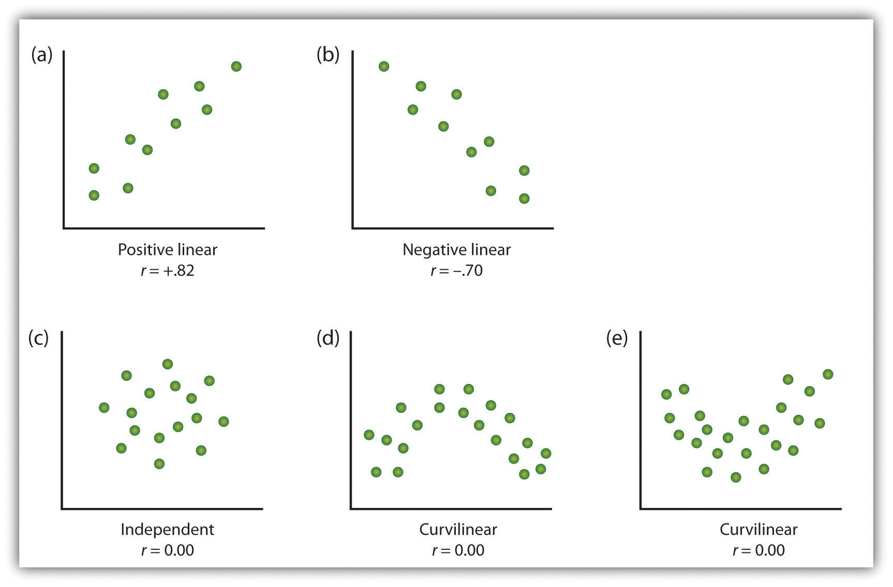



We hebben al aardig wat verschillende relaties (kwali vs. kwali, kwali vs. kwanti) en toetsen (bhi's, Bayes factor, t-toetsen, Chi^2^) behandeld. Wat nog mist in ons rijtje, is hoe we een relatie tussen twee kwantitatieve variabelen kunnen onderzoeken. Dit doen we middels een **correlatie**.

Correlaties zullen jullie niet onbekend klinken. In het dagelijks leven komen we vaak correlaties tegen in het nieuws of op de socials, waar de term meer algemeen wordt gebruikt om relaties tussen bepaalde dingen aan te duiden. Zo zijn er zelfs [websites](https://tylervigen.com/spurious-correlations) waar schijncorrelaties worden bijgehouden: correlaties die statistisch sterk zijn maar geen inhoudelijke betekenis hebben.

In de criminologie zijn we ook geïnteresseerd in correlaties. Bijvoorbeeld tussen leeftijd en hoeveel criminaliteit men pleegt (de age-crime curve) of tussen hoe vaak men op stap gaat en hoeveel er gedronken wordt.

We behandelen een correlatie hier dus in engere zin: als de sterkte van een verband tussen twee kwantitatieve variabelen. We gaan in op de volgende aspecten rondom een correlatie: hoe je deze berekent, statistische significantie en Bayes factor, een betrouwbaarheidsinterval, en waar je op moet letten bij de interpretatie. Belangrijk om te onthouden is dat een correlatie een populatieparameter is, net als andere populatieparameters die we hebben behandeld (proportie, gemiddelde, verschil in gemiddeldes, etc.). We willen dus schatten hoe sterk een verband tussen twee zaken is binnen een populatie.

We richtingen ons hier op de **Pearson** **correlatie**, die we aanduiden met de letter $r$ . Er bestaat ook nog de Spearman correlatie die gebruiken als minstens één van de twee variabelen een ordinaal meetniveau heeft, maar die laten we buiten beschouwen.

## Pils en paffen

Voor het voorbeeld grijpen we terug op wat we eerder behandeld hebben: [de relatie](002-04-relatiesvariabelen.qmd#sec-nominaalordinaal#sec-kwantikwanti) tussen het aantal genuttigde glazen alcohol en aantal sigaretten op een uitgaansdag.[^005-03-correlatie-1] We kunnen verwachten dat uitgaanders die meer drinken ook meer zullen roken, omdat drinken de trek in een sigaret vergroot voor veel mensen. Toch zullen we dit tweezijdig toetsen, zoals uitgelegd bij [Aspecten van hypothesetoetsing](004-02-aspectenhypo.qmd).[^005-03-correlatie-2]

[^005-03-correlatie-1]: Dit voorbeeld heeft alleen betrekking op uitgaanders die zowel minstens één glas alcohol als één sigaret hebben geconsumeerd.

[^005-03-correlatie-2]: De belangrijkste reden is dat we een betrouwbaarheidsinterval met twee grenzen kunnen berekenen.

### Hypothese opstellen

We stellen weer de nulhypothese op. In dit geval gaat de originele verwachting uit van positieve correlatie tussen aantal glazen alcohol en aantal sigaretten. De nulhypothese formuleren we dan als volgt:

H~0~: Er bestaat geen of een negatieve correlatie tussen het aantal gedronken glazen alcohol en aantal gerookte sigaretten op een uitgaansdag.

Statistisch krijgt dat de volgende vorm:

$$
r \le 0
$$

### Intuïtie correlatie

We beginnen de uitleg van het berekenen van een correlatie met wat intuïtie. We kijken daarbij eerst naar [spreidingsdiagrammen](002-04-relatiesvariabelen.qmd#sec-nominaalordinaal#sec-kwantikwanti) (ook wel puntenwolk of *scatterplot* genoemd). Deze geven ons vaak een eerste indruk van hoe de relatie tussen twee variabelen in elkaar zit. Een aantal voorbeelden staan in de figuur hieronder.

De stippen vertegenwoordigen een datapunt (een respondent) en geven aan hoe verschillende respondenten zowel op variabele x als y scoren. Dit toont al een centraal aspect van correlaties. Het draait namelijk om **co-variantie**: hoe variëren x en y *gezamenlijk*.

Wanneer een hogere score op x doorgaans samenhangt met een hogere score op y, spreken we van een *positieve* correlatie (grafiek a). Wanneer een hogere score op x doorgaans samenhangt met een lagere score op y, spreken we van een *negatieve* correlatie (grafiek b). Als er geen duidelijk verband is tussen de scores op x en y, zeggen we dat er geen correlatie lijkt te zijn (grafiek c).

Hoe dichter de punten bij elkaar liggen en één lijn vormen, hoe sterker de correlatie. De grootte van een correlatie $r$ kan variëren van -1 (perfecte negatieve relatie), tot 0 (geen relatie) tot en met +1 (perfecte positieve relatie).

Er zijn ook andere typen relaties mogelijk zoals weergeven in grafiek d en e waarbij de relatie niet-lineair is. Hiervoor kun je wel een correlatie berekenen, maar die beschrijft het verband niet goed. Daarom zijn correlaties alleen geschikt voor *lineaire* verbanden en is het vaak verstandig de relaties ook visueel te checken.

### Berekenen correlatie
